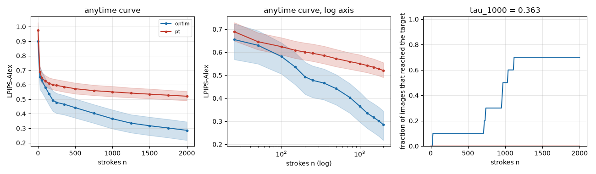

# Evaluation harness run: `outputs\eval\dev_smoke` (dev split)

Generated by `python -m scripts.eval_run report`. A dagger † marks a metric that is in the method's own loss (docs/design/evaluation.md 2.1). Cells are `mean ± std over images [95 % bootstrap interval of the mean] (mean over images of the replicate std)`.

## Run

| method | images | replicates (seeds) | replicate kind | failures |
|---|---|---|---|---|
| optim | 10 | [0] | init seed | 0 |
| pt | 10 | [0, 1, 2] | training seed | 0 |

GPU NVIDIA GeForce RTX 5070, driver 610.88, torch 2.11.0+cu128, commit 3a4120568c

## B1 final metrics at the budgets

| method | metric | n = 250 | n = 500 | n = 1000 | n = 2000 |
|---|---|---|---|---|---|
| optim | LPIPS-Alex | 0.478 ± 0.117 [0.402, 0.540] | 0.442 ± 0.110 [0.372, 0.502] | 0.366 ± 0.110 [0.297, 0.426] | 0.286 ± 0.106 [0.219, 0.345] |
| optim | LPIPS-VGG † | 0.567 ± 0.051 [0.535, 0.595] | 0.538 ± 0.047 [0.508, 0.564] | 0.470 ± 0.049 [0.440, 0.498] | 0.279 ± 0.059 [0.242, 0.311] |
| optim | L1 † | 0.060 ± 0.018 [0.048, 0.070] | 0.056 ± 0.018 [0.046, 0.066] | 0.044 ± 0.015 [0.035, 0.053] | 0.033 ± 0.013 [0.026, 0.041] |
| optim | SSIM | 0.569 ± 0.141 [0.493, 0.658] | 0.584 ± 0.138 [0.508, 0.670] | 0.629 ± 0.135 [0.552, 0.710] | 0.685 ± 0.129 [0.608, 0.760] |
| optim | PSNR (dB) | 20.121 ± 2.255 [18.843, 21.490] | 20.455 ± 2.243 [19.176, 21.814] | 22.484 ± 2.859 [20.934, 24.295] | 24.945 ± 2.993 [23.215, 26.758] |
| optim | LPIPS-Alex at 128 px | 0.239 ± 0.076 [0.193, 0.282] | 0.221 ± 0.072 [0.178, 0.262] | 0.147 ± 0.053 [0.116, 0.178] | 0.094 ± 0.041 [0.071, 0.119] |
| pt | LPIPS-Alex | 0.596 ± 0.064 [0.560, 0.636] (0.012) | 0.572 ± 0.064 [0.537, 0.612] (0.013) | 0.551 ± 0.061 [0.518, 0.588] (0.011) | 0.521 ± 0.055 [0.491, 0.554] (0.013) |
| pt | LPIPS-VGG | 0.644 ± 0.037 [0.622, 0.665] (0.006) | 0.636 ± 0.038 [0.614, 0.659] (0.007) | 0.628 ± 0.037 [0.606, 0.650] (0.006) | 0.615 ± 0.035 [0.595, 0.637] (0.005) |
| pt | L1 | 0.114 ± 0.029 [0.096, 0.130] (0.008) | 0.094 ± 0.025 [0.079, 0.109] (0.006) | 0.083 ± 0.022 [0.070, 0.096] (0.005) | 0.069 ± 0.019 [0.058, 0.081] (0.004) |
| pt | SSIM | 0.484 ± 0.140 [0.407, 0.570] (0.014) | 0.507 ± 0.140 [0.427, 0.592] (0.011) | 0.525 ± 0.137 [0.446, 0.608] (0.011) | 0.555 ± 0.131 [0.478, 0.632] (0.011) |
| pt | PSNR (dB) | 14.697 ± 1.864 [13.636, 15.778] (0.481) | 16.145 ± 1.867 [15.054, 17.235] (0.528) | 17.131 ± 1.892 [16.032, 18.244] (0.571) | 18.733 ± 2.002 [17.547, 19.909] (0.623) |
| pt | LPIPS-Alex at 128 px | 0.408 ± 0.081 [0.361, 0.457] (0.016) | 0.373 ± 0.084 [0.323, 0.422] (0.024) | 0.347 ± 0.085 [0.299, 0.398] (0.019) | 0.290 ± 0.085 [0.241, 0.341] (0.024) |

## Controls (section 2.2)

| reference | LPIPS-Alex | LPIPS-VGG | L1 | SSIM |
|---|---|---|---|---|
| blank_black | 0.975 ± 0.086 [0.926, 1.027] | 0.719 ± 0.033 [0.701, 0.739] | 0.419 ± 0.161 [0.332, 0.520] | 0.003 ± 0.003 [0.001, 0.005] |
| blank_white | 0.899 ± 0.125 [0.816, 0.959] | 0.757 ± 0.033 [0.738, 0.777] | 0.581 ± 0.161 [0.480, 0.668] | 0.377 ± 0.171 [0.292, 0.490] |
| blur | 0.241 ± 0.097 [0.185, 0.302] | 0.254 ± 0.062 [0.218, 0.291] | 0.016 ± 0.009 [0.011, 0.022] | 0.891 ± 0.079 [0.840, 0.933] |
| optim: native blank canvas | (1.0, 1.0, 1.0) |  |  |  |
| pt: pipeline canvas vs sequence render (mean abs diff) | 0.0065 ± 0.0016 [0.0056, 0.0075] |  |  |  |
| pt: native blank canvas | (0.0, 0.0, 0.0) |  |  |  |

## B2 anytime AUC

| method | AUC@250 | AUC@500 | AUC@1000 | AUC@2000 |
|---|---|---|---|---|
| optim | 0.573 ± 0.096 [0.509, 0.619] | 0.515 ± 0.094 [0.453, 0.562] | 0.458 ± 0.092 [0.398, 0.504] | 0.387 ± 0.091 [0.329, 0.435] |
| pt | 0.642 ± 0.041 [0.620, 0.668] (0.011) | 0.614 ± 0.043 [0.590, 0.640] (0.011) | 0.588 ± 0.044 [0.564, 0.615] (0.011) | 0.562 ± 0.045 [0.537, 0.590] (0.011) |

AUC@2000: raw integral, log-spaced variant (early strokes), and n >= 250 only (robustness to the canvas colour, 3.3):

| method | raw | log-spaced | n >= 250 |
|---|---|---|---|
| optim | 0.390 ± 0.108 [0.322, 0.450] | 0.494 ± 0.093 [0.432, 0.540] | 0.361 ± 0.091 [0.303, 0.409] |
| pt | 0.561 ± 0.059 [0.529, 0.598] (0.011) | 0.601 ± 0.042 [0.578, 0.627] (0.011) | 0.551 ± 0.046 [0.525, 0.579] (0.012) |

## B3 saliency-weighted LPIPS

| method | SW-LPIPS (λ=0.1) n = 250 | SW-LPIPS (λ=0.1) n = 500 | SW-LPIPS (λ=0.1) n = 1000 | SW-LPIPS (λ=0.1) n = 2000 |
|---|---|---|---|---|
| optim | 0.509 ± 0.049 [0.483, 0.540] | 0.496 ± 0.054 [0.467, 0.529] | 0.385 ± 0.061 [0.351, 0.422] | 0.314 ± 0.069 [0.277, 0.357] |
| pt | 0.580 ± 0.053 [0.551, 0.612] (0.012) | 0.545 ± 0.059 [0.512, 0.581] (0.014) | 0.514 ± 0.061 [0.480, 0.553] (0.013) | 0.474 ± 0.049 [0.446, 0.504] (0.013) |

Sensitivity at n = 1000: λ of the evaluator (inspyrenet), the control map (spectral_residual, λ=0.1), and the unweighted LPIPS-Alex:

| method | inspyrenet λ=0 | inspyrenet λ=0.1 | inspyrenet λ=0.3 | spectral_residual λ=0.1 | LPIPS-Alex |
|---|---|---|---|---|---|
| optim | 0.388 ± 0.059 [0.355, 0.423] | 0.385 ± 0.061 [0.351, 0.422] | 0.381 ± 0.069 [0.340, 0.422] | 0.396 ± 0.108 [0.332, 0.461] | 0.366 ± 0.110 [0.297, 0.426] |
| pt | 0.510 ± 0.063 [0.474, 0.550] (0.014) | 0.514 ± 0.061 [0.480, 0.553] (0.013) | 0.522 ± 0.058 [0.491, 0.560] (0.012) | 0.539 ± 0.083 [0.493, 0.591] (0.009) | 0.551 ± 0.061 [0.518, 0.588] (0.011) |

SW-LPIPS AUC@2000 (normalized by the per-image blank-canvas SW-LPIPS):

| method | SW-AUC@2000 |
|---|---|
| optim | 0.407 ± 0.046 [0.383, 0.436] |
| pt | 0.502 ± 0.044 [0.476, 0.528] (0.011) |

## B4 strokes-to-target

| target | method | reach the target within 2000 | median n* (censored kept at 2000) |
|---|---|---|---|
| tau_500 = 0.4394 | optim | 90 % (9/10 images) | 499 |
| tau_500 = 0.4394 | pt | 3 % (0/10 images) | 2000 (> 2000: censored) |
| tau_1000 = 0.3634 | optim | 70 % (7/10 images) | 999 |
| tau_1000 = 0.3634 | pt | 0 % (0/10 images) | 2000 (> 2000: censored) |
| tau_2000 = 0.2806 | optim | 50 % (5/10 images) | 1996 |
| tau_2000 = 0.2806 | pt | 0 % (0/10 images) | 2000 (> 2000: censored) |

## B5 runtime and VRAM

| method | timed runs (warm-up excluded) | runtime s, median [IQR] | peak VRAM GB (allocated) | reserved GB | min strokes emitted |
|---|---|---|---|---|---|
| optim | 9 of 10 | 583.43 [583.23, 584.24] | 3.44 [3.44, 3.44] | 3.60 [3.60, 3.60] | 2037 |
| pt | 27 of 30 | 21.71 [21.56, 21.84] | 1.19 [1.19, 1.20] | 3.60 [3.60, 3.60] | 2787 |

## Paired statistics

**F1 (confirmatory, Holm inside the family)**: a difference `a - b` is negative when `a` is better (lower).

| pair | endpoint | p / p Holm | rank-biserial r | median diff [95 % CI] | claim (p Holm < 0.05, CI excludes 0, |r| ≥ 0.3) | control map |
|---|---|---|---|---|---|---|
| optim vs pt | P1 LPIPS-Alex@1000 | 0.00195 / 0.00586 | -1.00 | -0.1532 [-0.2268, -0.1365] | yes |  |
| optim vs pt | P2 AUC@2000 | 0.00195 / 0.00586 | -1.00 | -0.1453 [-0.2102, -0.1197] | yes |  |
| optim vs pt | P3 SW-LPIPS@1000 | 0.00195 / 0.00586 | -1.00 | -0.1328 [-0.1640, -0.0968] | yes | same sign |

**Exploratory / secondary (uncorrected p-values, never a headline claim)**:

| pair | endpoint | p (uncorrected) | r | median diff [95 % CI] |
|---|---|---|---|---|
| optim vs pt | LPIPS-Alex@250 | 0.00195 | -1.00 | -0.0916 [-0.1510, -0.0654] |
| optim vs pt | AUC@250 | 0.0137 | -0.85 | -0.0513 [-0.0960, -0.0117] |
| optim vs pt | LPIPS-Alex@500 | 0.00195 | -1.00 | -0.1056 [-0.1579, -0.0856] |
| optim vs pt | AUC@500 | 0.00195 | -1.00 | -0.0733 [-0.1268, -0.0444] |
| optim vs pt | LPIPS-Alex@1000 | 0.00195 | -1.00 | -0.1532 [-0.2268, -0.1365] |
| optim vs pt | AUC@1000 | 0.00195 | -1.00 | -0.0972 [-0.1569, -0.0738] |
| optim vs pt | LPIPS-Alex@2000 | 0.00195 | -1.00 | -0.2008 [-0.2634, -0.1843] |
| optim vs pt | AUC@2000 | 0.00195 | -1.00 | -0.1453 [-0.2102, -0.1197] |
| optim vs pt | LPIPS-VGG@1000 | 0.00195 | -1.00 | -0.1489 [-0.1811, -0.1368] |
| optim vs pt | L1@1000 | 0.00195 | -1.00 | -0.0452 [-0.0493, -0.0262] |
| optim vs pt | SSIM@1000 | 0.00195 | +1.00 | +0.1080 [+0.0836, +0.1227] |

## Figure

