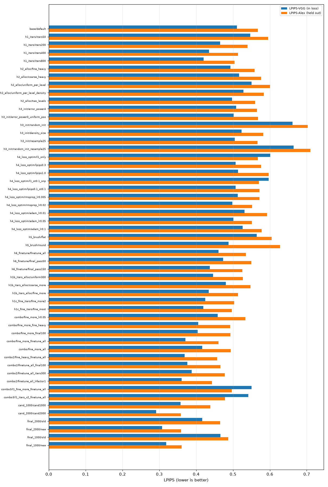
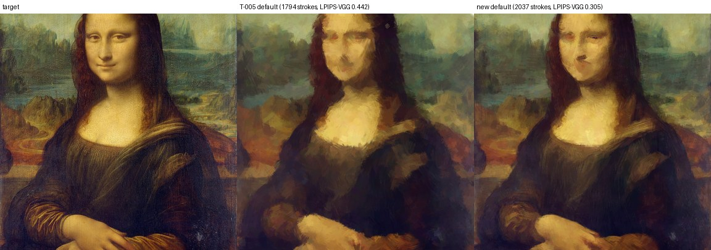

# T-009: closing the quality gap of the optimization baseline

**Question.** T-005 left a gap: on a 512² image with ~1800 strokes the baseline reached LPIPS-VGG 0.44 (target for M1: < 0.25).
Where does the gap come from, and how much of it can be closed within ~10 minutes per image?

**Answer in one paragraph.** The gap was mostly *under-optimization* plus a *frozen coarse-to-fine schedule*: giving the fine levels
many more steps and jointly re-optimizing the earlier strokes lowers the mean LPIPS-VGG from 0.416 to **0.308** and the held-out
LPIPS-AlexNet from 0.465 to **0.359** (5 images × 3 seeds, ~2000 strokes, 563 s per image, 3.3 GB VRAM). The target "LPIPS < 0.25" is
**not met on average** (it is met within 0.003 on the two smoothest images). It is also not a realistic target for this stroke
model: a *plain Gaussian blur of σ = 1 px* of the image, i.e. no painting at all, already has LPIPS-VGG 0.268 / Alex 0.318. A revised
M1 target is proposed at the end.

Everything below is regenerated by `python -m scripts.exp_optim_sweep` (tables:
[optim_sweep_tables.md](optim_sweep_tables.md), generated). The numbers quoted here are copied from those tables.

## Protocol
- **Images** (public domain, 512² center crops; sources, licenses, checksums in [../data_sources.md](../data_sources.md),
  fetched by `scripts/fetch_data.py`): *Mona Lisa*, *The Starry Night*, *The Great Wave*, *Girl with a Pearl Earring*, Apollo 17
  "Blue Marble".
- **Screening** (hypotheses H1–H6): 2 images (Mona Lisa: smooth portrait; Great Wave: high-frequency print), seed 0, ~1000 strokes
  (`s1000`: 994 strokes). ΔVGG/ΔAlex are *paired* differences against the T-005 default (`base/default`, same images, same seed),
  negative = better; they are more reliable than comparing the unpaired means because the two images differ a lot (L1 0.04 vs 0.09).
- **Confirmation**: T-005 default ("old") vs new default, 5 images × 3 seeds, at ~1000 and ~2000 strokes.
- **Metrics**: L1, PSNR, **LPIPS-VGG** (also a term of the training loss, weight 0.1, so optimistic) and **LPIPS-AlexNet** (never used
  in any loss: the held-out metric; conclusions rely on it), runtime, peak VRAM (`torch.cuda.max_memory_allocated`).
- **Hardware**: RTX 5070 12 GB, one run at a time (a first attempt with two parallel workers filled the VRAM and was killed and
  restarted single-process). Runtime columns of a few rows in `h4_loss_optim` (OT variants, RMSprop) are inflated by me running
  other jobs on the machine at the same time; the base/confirmation rows were measured alone.
- **Seeds**: in the confirmation, the standard deviation over seeds *for a given image* is ≤ 0.007 (LPIPS) and ≤ 0.001 (L1); the ± in the
  aggregate rows is dominated by differences between images. Screening used one seed, so differences below ~0.01 should be read as
  "no effect".

## Verdicts

| H | verdict | evidence (paired Δ vs T-005 default, ΔVGG / ΔAlex) |
|---|---------|------------------|
| H1 under-optimization | **confirmed, the largest single factor** | steps/level 50: +0.036 / +0.029; 200: −0.046 / −0.028; 400: −0.075 / −0.054; 800: −0.091 / −0.063 (time 43 → 687 s) |
| H2 stroke allocation | **small effect** | fine_heavy −0.018 / −0.009; two_levels −0.013 / −0.007; coarse_heavy +0.006 / +0.009; uniform-per-level +0.040 / +0.034 |
| H3 initialization | **no effect of the error map; target colours essential** | error power 4: −0.002 / −0.002; uniform positions: −0.009 / +0.001; resampling: −0.005 / −0.001; random positions *and* colours: **+0.151 / +0.136** |
| H4 loss / optimizer | LPIPS term helps *VGG only* at 100 steps; OT useless; lr matters a little | see below |
| H5 brush | **texture helps perceptually** (held-out metric) | flat +0.054 / +0.038; round −0.022 / **+0.061** |
| H6 joint fine-tuning | **confirmed, second largest factor** | finetune_all −0.050 / −0.032; final pass (150 steps) −0.073 / −0.042 |
| H7 target realism | **target unrealistic** | blur floors, published numbers: see below |

### H1: steps (screening, s1000, 2 images)
Training loss is still decreasing at 100 steps/level for every level ([convergence figure](optim_sweep_convergence.png)), so the T-005
default had not converged. Held-out LPIPS-Alex improves monotonically with steps, with diminishing returns (×8 time for −0.063).
**Where the steps go matters** (H1b, roughly equal cost ~270–320 s): 100 steps at the coarse levels and 400 at the three finest
(`fine_more`) gives −0.076 / −0.054, better than 300 everywhere (−0.065 / −0.040) and better than putting the extra steps on the coarse
levels (−0.030 / −0.020). Coarse levels are cheap (about 5 s per 100 steps, versus 32 s at the finest level of s1000) but converge fast;
the fine levels hold the remaining error. Going further (H1c): 300/600/600 steps −0.010 / −0.010 more for +85 s; 200/600/1000 −0.014 /
−0.017 for +200 s: diminishing.

### H2: allocation across levels (s1000, ~1000 strokes)
Moving strokes to the fine levels with fewer, coarser early levels (`fine_heavy`: grids 1, 2, 4, 8, 16 with 1, 1, 1, 3, 3 strokes per
patch) is slightly better (−0.018 / −0.009) and its peak VRAM was lower in our runs (3.1 vs 6.5 GB); the opposite
(many strokes at coarse levels, or the same number of strokes at every level) is worse. Sizing initial strokes by stroke density instead of
patch size does not help (+0.013 / +0.015). Effects are ≤ 0.02 except for the clearly bad schedules: allocation is not where the gap is.

### H3: initialization
Sampling positions from the residual error versus uniformly inside each patch makes no difference (−0.009 / +0.001), nor does re-drawing
"dead" strokes every 25 steps (−0.005 / −0.001; we did not count how many strokes were re-drawn). Reading colours from the target is
what matters: fully random initialization (positions and colours) is far worse (+0.15) because 100 steps cannot repair random colours.

### H4: loss and optimizer
- **LPIPS weight** (T-005 default 0.1): removing it (L1 only) raises LPIPS-VGG by 0.091 (it is in the loss) but leaves the held-out
  LPIPS-Alex unchanged (ΔAlex 0.000) at 100 steps, while lowering L1 (0.0548 vs 0.0618) and the run time (62 vs 87 s). So the T-005
  LPIPS-VGG improvement did **not** transfer to another perceptual metric at that budget. With long optimization it does: with the
  fine-level/joint settings of H6, L1-only gives Alex 0.496 vs 0.461 with LPIPS 0.1 (mean of 2 images: ΔAlex +0.036; 0.478 with twice
  the steps, +0.017) but L1 0.0481 vs 0.0541 (a trade-off between pixel fidelity and perceptual quality). Weights 0.3 and 1.0 do not help
  (ΔAlex +0.009 / +0.030).
- **Sinkhorn OT** (SNP's recommended L1 + 0.1·OT): no measurable effect (L1 + OT: ΔAlex +0.003; with LPIPS: +0.005) at roughly double the
  runtime. We keep the implementation (tested) but it is off by default.
- **Optimizer**: Adam lr 0.05 (−0.009 / −0.016) and RMSprop lr 0.02 (−0.012 / −0.016) are slightly better than Adam lr 0.02 at 100 steps;
  lr 0.01 and 0.1 are worse (+0.021 / +0.025, +0.015 / +0.010); RMSprop lr 0.005 equal. With a long schedule the higher lr is *worse*
  (Adam 0.05 on top of `fine_more`: +0.024 / +0.020), so the default stays Adam lr 0.02 with cosine decay.

### H5: brush
On the held-out metric the textured oil brush is clearly the best: flat strokes cost +0.038 Alex, round dabs +0.061 Alex. LPIPS-VGG
(in the loss) is *fooled* by round dabs (−0.022): it would have ranked the round brush first, which the held-out metric contradicts.
Pixel L1 is marginally lower with flat (0.0580) and round (0.0574) than with oil (0.0618), so the expectation "texture reduces
achievable fidelity" is true only for L1 (−6 %), not for perceptual similarity.

### H6: joint fine-tuning of earlier strokes
Re-optimizing all earlier strokes together with the new ones at every level (`finetune_all`) is the best single change after more steps:
−0.050 / −0.032 on the T-005 schedule (+68 s) and −0.063 / −0.053 on top of `fine_more` (511 s). A single final joint pass after the last level is cheaper
but weaker (50 steps −0.037 / −0.017; 150 steps −0.073 / −0.042). Refinements: giving the earlier strokes the same learning rate as
the new ones (`finetune_lr_factor` 1.0 instead of 0.3) −0.010 / −0.017 more; adding a final pass or more steps on top of `finetune_all`
no longer helps (+0.005; 300 instead of 400 steps +0.017). Cost: every step renders all strokes, so run time grows (~1.8× at s1000).

### H7: is LPIPS < 0.25 realistic?
*Reference floors without any stroke* (mean over the 5 images, target vs degraded target):

| degradation | LPIPS-VGG | LPIPS-Alex | L1 |
|-------------|-----------|------------|----|
| Gaussian blur σ = 1 px | 0.268 | 0.318 | 0.030 |
| down-up ×2 (256² and back) | 0.325 | 0.372 | 0.035 |
| Gaussian blur σ = 2 px | 0.432 | 0.537 | 0.044 |
| down-up ×4 (128² and back) | 0.468 | 0.565 | 0.047 |
| **new default, 2037 strokes** | **0.308** | **0.359** | **0.051** |
| T-005 default, 1938 strokes | 0.416 | 0.465 | 0.056 |

LPIPS penalizes loss of fine texture even when the colours and shapes are right; a stroke painting with ~2000 strokes at 512² (stroke
lengths of about 15–40 px at the finest levels) removes high-frequency detail by construction. The new default sits between a σ = 1 blur and a ×2
down-up-sample; reaching 0.25 on average would require beating a 1-pixel blur of the image, which is a *fidelity* requirement at the
level of 5–10 k strokes, not an abstraction (painterly) one. The two smooth images (Girl with a Pearl Earring, Earth) do reach 0.253 / 0.251
(VGG) and 0.218 / 0.283 (Alex); the textured paintings (Great Wave 0.378, Starry Night 0.349) cannot.

*Published numbers.* None of the three reference methods reports LPIPS. Checked on the arXiv versions:
- Stylized Neural Painting (Zou et al., CVPR 2021): the only quantitative metric is the PSNR of the *neural renderer* (oil-paint stroke at
  128²: 26.98 dB with rasterization + shading); the comparison with Learning to Paint (400 strokes) and SPIRAL is visual; the pixel ℓ2 is a
  training loss.
- Paint Transformer (Liu et al., ICCV 2021), Table 1, real images (512², same stroke count for all methods): pixel loss RL 0.040, Optim
  (SNP-style optimization) 0.059, PT 0.056; their perceptual loss (a VGG feature distance, not LPIPS) 0.737 / 0.856 / 0.807. Our final L1 on
  the same kind of images is 0.051 on average (0.033 on the Mona Lisa), i.e. at least as good as their optimization baseline in pixel loss
  (definitions of their "pixel loss" and stroke counts are not given in the table, so this is indicative only).
- Learning to Paint (Huang et al., ICCV 2019): not re-checked in this ticket; to our knowledge it reports a pixel L2 loss, not LPIPS.
So a numerical LPIPS target is not anchored in the literature; it was a guess in the M1 plan.

## New default (`configs/baseline_optim.yaml`)
Grids 1, 2, 4, 8, 16, 20 with 1, 1, 1, 3, 4, 2 strokes per patch (2037 strokes), steps per level 100, 100, 100, 300, 300, 150,
`finetune_all: true` (same learning rate for the earlier strokes), Adam lr 0.02 (cosine to 0.1×), L1 + 0.1·LPIPS-VGG, oil brush, error-map
initialization. Chosen from `combo`, `combo2`, `cand_*` of the sweep; the choice is a combination of the individually best changes
(H1b, H2, H6) with the loss/optimizer left at the T-005 values (H4: no robust gain). The sweep keeps the T-005 settings frozen in
`configs/experiments/baseline_t005.yaml` so the tables remain reproducible.

Confirmation (5 images × 3 seeds, mean ± std over the 15 runs; ΔVGG/ΔAlex paired vs old). "old" means the **T-005 settings on the
same stroke schedule as the row**: `s2000` (1938 strokes) for the ~2000 budget and `s1000` (994 strokes) for the ~1000 budget. It is
not the 1794-stroke schedule of the T-005 configuration file (`configs/experiments/baseline_t005.yaml`).

| budget | config | strokes | L1 | PSNR | LPIPS-VGG | LPIPS-Alex | ΔVGG | ΔAlex | time | VRAM |
|--------|--------|---------|----|------|-----------|------------|------|-------|------|------|
| ~2000 | old (T-005) | 1938 | 0.0564 ± 0.0218 | 21.40 | 0.416 ± 0.059 | 0.465 ± 0.108 | – | – | 154 s | 6.5 GB |
| ~2000 | **new** | 2037 | 0.0510 ± 0.0201 | 22.14 | **0.308 ± 0.053** | **0.359 ± 0.102** | −0.109 | −0.106 | 563 s | 3.3 GB |
| ~1000 | old | 994 | 0.0595 ± 0.0225 | 20.92 | 0.466 ± 0.057 | 0.487 ± 0.103 | – | – | 85 s | 6.5 GB |
| ~1000 | **new** (fine_heavy, steps 100/100/100/400/600) | 981 | 0.0512 ± 0.0206 | 22.15 | 0.319 ± 0.054 | 0.360 ± 0.100 | −0.147 | −0.127 | 521 s | 3.3 GB |

Per image at ~2000 strokes (mean ± std over 3 seeds; full tables incl. 1000 strokes in the generated file):

| image | old VGG / Alex | new VGG / Alex | new L1 |
|-------|----------------|----------------|--------|
| mona_lisa | 0.433 / 0.511 | 0.308 / 0.379 | 0.0332 |
| starry_night | 0.478 / 0.555 | 0.349 / 0.415 | 0.0708 |
| great_wave | 0.474 / 0.573 | 0.378 / 0.499 | 0.0721 |
| pearl_earring | 0.344 / 0.304 | 0.253 / 0.218 | 0.0242 |
| earth_apollo17 | 0.354 / 0.383 | 0.251 / 0.283 | 0.0545 |

The improvement is consistent on every image and both budgets (the held-out LPIPS-Alex improves by 0.10–0.13), and it is not an artefact
of the training loss: LPIPS-Alex was never optimized. Runtime is 9.4 min at ~2000 strokes (≤ 10 min target) and 8.7 min at ~1000.

## Is the M1 target met? — **No.** Proposed revised target
- **Not met**: mean LPIPS-VGG at ~2000 strokes is 0.308 (not < 0.25); 2 of 5 images are within 0.003 of it.
- **Justification of a revision**: the target was a guess that no cited method supports (none reports LPIPS), and a 1-pixel Gaussian blur
  of the image already scores 0.268 (VGG) / 0.318 (Alex) on these images.
- **Proposal for the chef**: replace "LPIPS < 0.25" by **LPIPS-VGG ≤ 0.35 and LPIPS-Alex ≤ 0.40, averaged over a diverse set of
  images (paintings and photographs), at ≤ 2000 strokes and ≤ 10 min per 512² image, reported with the held-out metric and per-image
  numbers**; the current default achieves 0.308 / 0.359. For the demos (T-007): choose smooth, subject-centred inputs (portraits such as the
  Vermeer, or photos like the Earth) to show ≤ 0.26 / 0.30; textured inputs (Great Wave, Starry Night) will sit around 0.35–0.38 / 0.42–0.50.
  A defensible research target for M3 is **relative**: beat this baseline's LPIPS at equal stroke budget.

## Caveats and follow-ups
- Screening used 2 images and 1 seed; each ΔAlex is a difference of two paired runs. Effects below ~0.01 are not distinguishable from
  noise (seed-to-seed std is ≤ 0.007 for a fixed image). The confirmation covers 5 images × 3 seeds.
- Interactions were explored along one path (steps → joint fine-tuning → lr), not a full grid; combining the schedule changes with a longer
  budget was not repeated for every hypothesis (e.g. the OT term was only tested at 100 steps).
- LPIPS (VGG) in the loss costs ~35 % of the run time; the new default keeps it since it helps the held-out metric with long
  optimization (H4).
- The dominant cost is rasterizing every stroke over the whole canvas at every step; cropping each stroke to its bounding box would
  allow more strokes/steps in the same time (proposed ticket).
- Runtimes are for one run at a time on an RTX 5070; some `h4_loss_optim` runtimes were measured while other jobs ran and are inflated.
