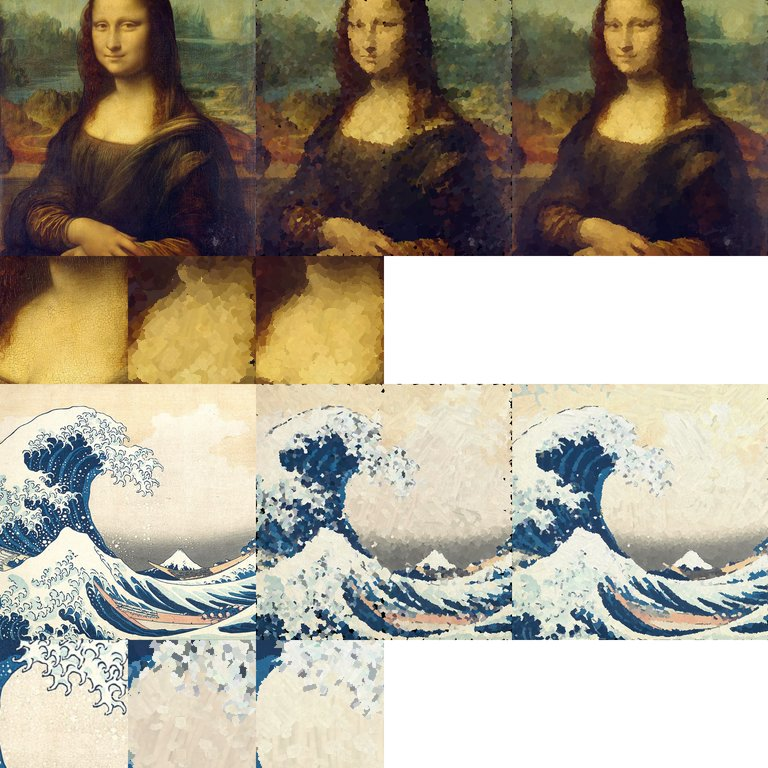
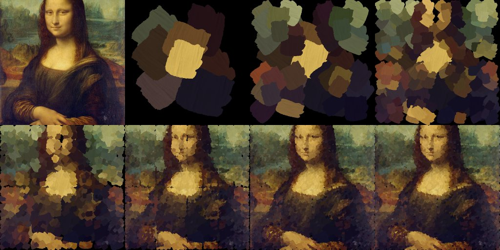

# Paint Transformer multi-scale inference (T-015)

**Question.** Does our inference pipeline (`brushstroke/stroke_model/inference.py`) reproduce the official Paint Transformer procedure exactly, what does it produce in terms of strokes, time and memory at 512 x 512, is the exported
`StrokeSequence` the painting of the pipeline, and what does the optional per-patch refinement bring? **Short answer:** with the official weights our output is **bit-identical** to the official `inference.py` (maximum absolute difference 0.0, same strokes in every layer), the
released model's stroke range (3.8 to 5.0 k strokes) is reproduced with both the official weights and our T-014 checkpoint, one image takes about 0.23 s and 1.05 GB, a sequence-aware replay reproduces the pipeline canvas to float rounding, and the per-patch refinement lowers L1 by about 27-35 % (and the held-out LPIPS-Alex by 0.08-0.06)
at 10 s per image.

## Protocol
- Images: the five evaluation images of the T-010 study (`data/raw`: Mona Lisa, Starry Night, The Great Wave, Girl with a Pearl Earring, Earth from Apollo 17; sources and licences in `docs/data_sources.md`), centre-cropped and resized to 512 x 512 (bicubic, antialiased), stored as 8-bit PNG,
  which both pipelines read.
- Models: the official released weights (`model.pth`, SHA-256 pinned in `scripts/pt_reference_study.py`) and the T-014 selected checkpoint `outputs/pt_long/seed2/latest.pt` (112,640 steps, seed 2, `h > 0` on all the strokes of these images).
- **Parity:** `scripts.pt_reference_study.official_paint` runs the official `inference.py:main` (parallel mode, same device) and captures its **float** output (the script itself saves `(x * 255).astype(uint8)`, which truncates); ours is `paint(...)` with the official weights. Reported: maximum and mean absolute difference, pixels that differ by more than 1/255, difference of the 8-bit images the
  official script would write, stroke count per layer. One extra row at 1024 x 1024 (K = 5) checks the layer count and the larger windows.
- **Variants, time, VRAM:** both final-layer variants of every image and model: `official` (all 2,312 shifted-layer strokes painted) and `gated` (`logit > 0` only), metrics of `brushstroke.eval.metrics` against the target (L1, PSNR, SSIM, LPIPS-VGG, LPIPS-Alex). Time = median of 5 runs after 2 warm-up runs of `paint` (network, rendering and sequence conversion; the model and the brush images
  are already loaded), measured **before** the LPIPS networks are loaded; VRAM = `torch.cuda.max_memory_allocated` since the start of the run (it includes the network, the brushes and the image). RTX 5070, PyTorch 2.11 + CUDA.
- **Sequence check:** the exported sequence of the `official` variant is re-rendered (a) by `replay_sequence` (layer-aware) and (b) by the generic `StrokeSequence.render` with `RenderConfig(mode="pt")`, and compared with the pipeline canvas.
- **Refinement:** `refine.enabled=true` (100 iterations per layer, lr 0.05), a few variants of the setting, on Mona Lisa and The Great Wave (the two images with the most and the least texture of the set). L1, PSNR, SSIM and LPIPS-VGG are close to the optimized objective (L1; the M1 baseline also uses LPIPS-VGG in its loss), **LPIPS-Alex is the held-out metric** (not used by the refinement).
- Everything below the line is generated by `python -m scripts.pt_inference_study report` from `docs/experiments/data/pt_inference/*.json` (no GPU needed); the stages `parity`, `variants`, `refine`, `layers` (GPU, official code) rewrite those files and the figures.

## Results

<!-- BEGIN GENERATED -->

### Parity with the official `inference.py` (official weights)

| image | size | strokes (official code / ours) | max abs diff | mean abs diff | pixels > 1/255 | max diff of the 8-bit PNGs |
|---|---|---|---|---|---|---|
| mona_lisa | 512 | 4376 / 4376 | 0.0e+00 | 0.0e+00 | 0 | 0 |
| starry_night | 512 | 4991 / 4991 | 0.0e+00 | 0.0e+00 | 0 | 0 |
| great_wave | 512 | 4330 / 4330 | 0.0e+00 | 0.0e+00 | 0 | 0 |
| pearl_earring | 512 | 3787 / 3787 | 0.0e+00 | 0.0e+00 | 0 | 0 |
| earth_apollo17 | 512 | 4194 / 4194 | 0.0e+00 | 0.0e+00 | 0 | 0 |
| mona_lisa | 1024 | 18835 / 18835 | 0.0e+00 | 0.0e+00 | 0 | 0 |

### Final-layer variants, stroke counts, runtime and VRAM

**official weights** (512 x 512; strokes per layer 0..K and the shifted final layer):

| image | strokes official / gated | per layer | L1 off. / gated | PSNR off. / gated | SSIM off. / gated | LPIPS-VGG off. / gated | LPIPS-Alex off. / gated | time (s) | VRAM (MiB) |
|---|---|---|---|---|---|---|---|---|---|
| mona_lisa | 4376 / 3566 | [8, 32, 125, 450, 1449, 2312] | 0.0432 / 0.0435 | 24.34 / 24.26 | 0.4492 / 0.4487 | 0.6536 / 0.6580 | 0.6212 / 0.6290 | 0.22 | 1047 |
| starry_night | 4991 / 4904 | [8, 32, 128, 511, 2000, 2312] | 0.0821 / 0.0821 | 18.83 / 18.83 | 0.2403 / 0.2399 | 0.6168 / 0.6172 | 0.4975 / 0.4979 | 0.24 | 1047 |
| great_wave | 4330 / 3569 | [8, 31, 113, 416, 1450, 2312] | 0.0995 / 0.0999 | 15.53 / 15.47 | 0.4212 / 0.4223 | 0.5699 / 0.5708 | 0.5082 / 0.5125 | 0.23 | 1047 |
| pearl_earring | 3787 / 2481 | [8, 28, 98, 320, 1021, 2312] | 0.0404 / 0.0414 | 22.73 / 22.66 | 0.5476 / 0.5332 | 0.5690 / 0.5700 | 0.4803 / 0.4826 | 0.23 | 1047 |
| earth_apollo17 | 4194 / 3201 | [8, 32, 113, 395, 1334, 2312] | 0.0701 / 0.0705 | 18.20 / 18.18 | 0.4100 / 0.4032 | 0.5114 / 0.5095 | 0.3701 / 0.3720 | 0.23 | 1047 |
| **mean** | 4336 / 3544 | | 0.0671 / 0.0675 | 19.92 / 19.88 | 0.4137 / 0.4094 | 0.5841 / 0.5851 | 0.4955 / 0.4988 | 0.23 | 1047 |

**T-014 seed 2** (512 x 512; strokes per layer 0..K and the shifted final layer):

| image | strokes official / gated | per layer | L1 off. / gated | PSNR off. / gated | SSIM off. / gated | LPIPS-VGG off. / gated | LPIPS-Alex off. / gated | time (s) | VRAM (MiB) |
|---|---|---|---|---|---|---|---|---|---|
| mona_lisa | 4618 / 4005 | [8, 32, 128, 482, 1656, 2312] | 0.0430 / 0.0431 | 24.23 / 24.23 | 0.4513 / 0.4522 | 0.6571 / 0.6564 | 0.6134 / 0.6172 | 0.23 | 1047 |
| starry_night | 5020 / 4982 | [8, 32, 128, 512, 2028, 2312] | 0.0908 / 0.0908 | 17.83 / 17.83 | 0.2129 / 0.2130 | 0.6506 / 0.6505 | 0.5351 / 0.5358 | 0.24 | 1047 |
| great_wave | 4368 / 3633 | [8, 32, 115, 414, 1487, 2312] | 0.1116 / 0.1111 | 14.63 / 14.68 | 0.3898 / 0.3936 | 0.5853 / 0.5858 | 0.5295 / 0.5300 | 0.23 | 1047 |
| pearl_earring | 3881 / 2696 | [8, 32, 99, 338, 1092, 2312] | 0.0366 / 0.0368 | 22.50 / 22.54 | 0.6481 / 0.6459 | 0.5389 / 0.5457 | 0.4221 / 0.4299 | 0.23 | 1047 |
| earth_apollo17 | 4358 / 3500 | [8, 32, 117, 419, 1470, 2312] | 0.0741 / 0.0743 | 17.67 / 17.68 | 0.4316 / 0.4164 | 0.5333 / 0.5277 | 0.3769 / 0.3757 | 0.23 | 1047 |
| **mean** | 4449 / 3763 | | 0.0712 / 0.0712 | 19.37 / 19.39 | 0.4267 / 0.4242 | 0.5930 / 0.5932 | 0.4954 / 0.4978 | 0.23 | 1047 |

### The exported `StrokeSequence` against the pipeline canvas

| model | image | strokes | replay: max abs / mean abs / pixels > 1/255 | generic `StrokeSequence.render`: mean abs / pixels > 1/255 | raw `h < 0` |
|---|---|---|---|---|---|
| official weights | mona_lisa | 4376 | 6.7e-02 / 5.7e-07 / 1 | 0.0050 / 84000 | 0.0 % |
| official weights | starry_night | 4991 | 5.7e-02 / 8.1e-07 / 2 | 0.0082 / 115019 | 0.0 % |
| official weights | great_wave | 4330 | 1.4e-04 / 8.9e-07 / 0 | 0.0102 / 125737 | 0.0 % |
| official weights | pearl_earring | 3787 | 3.6e-02 / 3.9e-07 / 1 | 0.0042 / 53147 | 0.0 % |
| official weights | earth_apollo17 | 4194 | 7.4e-02 / 8.6e-07 / 2 | 0.0076 / 88603 | 0.0 % |
| T-014 seed 2 | mona_lisa | 4618 | 2.2e-02 / 4.3e-07 / 1 | 0.0052 / 87179 | 0.0 % |
| T-014 seed 2 | starry_night | 5020 | 2.5e-01 / 1.5e-06 / 2 | 0.0088 / 109323 | 0.0 % |
| T-014 seed 2 | great_wave | 4368 | 3.3e-01 / 1.9e-06 / 2 | 0.0114 / 136147 | 0.0 % |
| T-014 seed 2 | pearl_earring | 3881 | 3.0e-01 / 1.3e-06 / 2 | 0.0045 / 55754 | 0.0 % |
| T-014 seed 2 | earth_apollo17 | 4358 | 3.3e-01 / 3.3e-06 / 4 | 0.0077 / 90103 | 0.0 % |

### Per-patch refinement

| model | image | refinement | L1 | PSNR (dB) | SSIM | LPIPS-VGG | LPIPS-Alex | time (s) | patch loss before -> after (layers 0..K+1) |
|---|---|---|---|---|---|---|---|---|---|
| official weights | mona_lisa | off | 0.0432 | 24.34 | 0.4492 | 0.6536 | 0.6212 | 0.5 | - |
| official weights | mona_lisa | default (100 it, lr 0.05) | 0.0322 | 26.99 | 0.5224 | 0.6212 | 0.5502 | 10.6 | 0.190->0.100 0.096->0.078 0.068->0.055 0.051->0.043 0.042->0.036 0.032->0.028 |
| official weights | great_wave | off | 0.0995 | 15.53 | 0.4212 | 0.5699 | 0.5082 | 0.2 | - |
| official weights | great_wave | default (100 it, lr 0.05) | 0.0717 | 17.23 | 0.4946 | 0.5425 | 0.4598 | 10.8 | 0.330->0.220 0.173->0.135 0.132->0.113 0.114->0.099 0.093->0.081 0.070->0.062 |
| T-014 seed 2 | mona_lisa | off | 0.0430 | 24.23 | 0.4513 | 0.6571 | 0.6134 | 0.3 | - |
| T-014 seed 2 | mona_lisa | default (100 it, lr 0.05) | 0.0314 | 27.18 | 0.5299 | 0.6106 | 0.5325 | 10.5 | 0.216->0.112 0.100->0.073 0.067->0.053 0.051->0.042 0.041->0.035 0.032->0.027 |
| T-014 seed 2 | mona_lisa | colour fixed | 0.0360 | 26.17 | 0.5055 | 0.6322 | 0.5638 | 10.2 | 0.216->0.140 0.118->0.092 0.074->0.060 0.053->0.047 0.045->0.040 0.035->0.031 |
| T-014 seed 2 | mona_lisa | short (30 it, lr 0.02) | 0.0347 | 26.08 | 0.4998 | 0.6353 | 0.5740 | 3.2 | 0.216->0.200 0.146->0.128 0.087->0.077 0.060->0.054 0.047->0.042 0.034->0.031 |
| T-014 seed 2 | mona_lisa | long (300 it, lr 0.05) | 0.0302 | 27.54 | 0.5438 | 0.6013 | 0.5067 | 29.0 | 0.216->0.101 0.097->0.068 0.066->0.050 0.049->0.039 0.040->0.033 0.031->0.026 |
| T-014 seed 2 | great_wave | off | 0.1116 | 14.63 | 0.3898 | 0.5853 | 0.5295 | 0.2 | - |
| T-014 seed 2 | great_wave | default (100 it, lr 0.05) | 0.0724 | 17.18 | 0.4888 | 0.5434 | 0.4662 | 10.1 | 0.521->0.189 0.167->0.143 0.145->0.122 0.123->0.101 0.099->0.081 0.077->0.063 |
| T-014 seed 2 | great_wave | colour fixed | 0.0883 | 16.67 | 0.4649 | 0.5551 | 0.4813 | 10.6 | 0.521->0.236 0.190->0.159 0.157->0.136 0.135->0.119 0.113->0.097 0.088->0.076 |
| T-014 seed 2 | great_wave | short (30 it, lr 0.02) | 0.0913 | 15.75 | 0.4352 | 0.5648 | 0.5005 | 3.4 | 0.521->0.454 0.251->0.217 0.178->0.164 0.151->0.138 0.120->0.109 0.089->0.080 |
| T-014 seed 2 | great_wave | long (300 it, lr 0.05) | 0.0687 | 17.35 | 0.5105 | 0.5236 | 0.4174 | 29.6 | 0.521->0.153 0.159->0.136 0.140->0.111 0.117->0.091 0.094->0.076 0.075->0.059 |



<!-- END GENERATED -->

Figures: `docs/media/pt_inference_layers.jpg` (target, canvas after layers 0 to 4, confidence-gated and official final painting; Mona Lisa, T-014 checkpoint) and `docs/media/pt_inference_refine.jpg`
(rows: Mona Lisa and The Great Wave; columns: target, Paint Transformer, with refinement; second line of each row: 2x detail of a 128 px crop). The "time" of the first row of the refinement table includes the CUDA warm-up.



## Findings
1. **Exact reproduction of the official procedure.** With the official weights our output is **bit-identical** to the official script on the five images at 512 x 512 and on a 1024 x 1024 image (K = 5), with the same number of strokes in each layer
   (target: <= 1/255). Getting there required three corrections found by comparing intermediate canvases (design note, section 14): the painting lives at full resolution in every layer (the T-010 note said otherwise), the network must use the official memory layout (one or two ulps of difference were enough to flip a few binary
   decisions and to change the final image by up to 0.3), and the brush choice must compare pixel sizes on non-square canvases. The same test runs on a synthetic square and a padded non-square image in `tests/test_pt_inference.py`.
2. **Stroke counts and cost.** At 512 x 512: 3,787 to 4,991 strokes with the official weights (mean 4,336, the T-010 range) and 3,881 to 5,020 with the T-014 checkpoint (mean 4,449; at most 5,040 are possible); in the `gated` variant 2,481 to 4,982. One image takes **0.23 s** (median of 5) and
   **1.05 GB** of allocated memory at peak (the 1024 x 1024 px window of layer 0 dominates), against 0.5-0.9 s and 2.3 GB for the official script in T-010 (loading included there) and 0.30 s on a 2080 Ti in the paper.
3. **The forced final-layer strokes are nearly useless.** The official variant paints all 2,312 strokes of the shifted layer, between 13 and 35 % of the strokes of an image have `logit <= 0` there (Starry Night: 1 to 2 %). Dropping them changes the mean L1 by +0.6 % with the official weights (0.0671 -> 0.0675) and by 0 with the T-014 checkpoint (0.0712; the largest single change is +2.5 % on Girl with a Pearl Earring, 3,787 -> 2,481 strokes) and LPIPS-Alex by +0.003, for 18 % (official weights) and 15 % (T-014) fewer strokes.
   For animation and for stroke budgets the `gated` variant is the better default; `official` is kept as the default of the config because it is what the official code and the paper-comparison targets use.
4. **Our checkpoint is not better than the official weights on real images**, although its held-out synthetic loss is 8 % lower (T-014). Means over the five images: L1 0.0712 against 0.0671 (+6 %), PSNR 19.4 against 19.9 dB, SSIM 0.427 against 0.414, LPIPS-VGG 0.593 against 0.584, LPIPS-Alex 0.4954 against 0.4955. Per image the picture is mixed (ours is better on Girl with a Pearl Earring: L1 0.0366 against 0.0404, SSIM 0.648 against 0.548; worse on Starry Night, The Great Wave and Earth).
   Five images do not allow a ranking with confidence, but they show that the ordering of the synthetic validation loss does not transfer one to one to the real-image pixel error; the reproduction ticket will have to compare on the paper's 300 images. Nothing in the pipeline explains the gap (the official weights go through the same code and match the official output exactly).
5. **The exported sequence is the painting, to float rounding, with the replay.** `replay_sequence` reproduces the pipeline canvas with a mean absolute difference of 4e-7 to 3e-6 and 0 to 4 pixels (of 262,144) that differ by more than 1/255 (alpha thresholds flipped by the float rounding of the parameter round trip; the largest single difference is 0.33).
   The generic `StrokeSequence.render` in `pt` mode is close but not equal: mean absolute difference 0.004 to 0.011 (1 to 3 grey levels), 20 to 52 % of the pixels differ by more than 1/255, because it samples the brush texture at the final resolution (the pipeline resizes the brush to the window of each layer: 1024 px at layer 0, 64 px at layer 4) and does not clip the strokes at their window. The strokes are the same; downstream
   consumers that need the exact appearance of Paint Transformer should use `replay_sequence` (it needs the tags written by `paint`).
6. **Refinement works and costs 10 s.** 100 iterations per layer lower L1 from 0.0430 to 0.0314 (-27 %) on Mona Lisa and from 0.1116 to 0.0724 (-35 %) on The Great Wave with the T-014 checkpoint (official weights: -25 % and -28 %), PSNR +3.0 and +2.6 dB, SSIM +0.08 and +0.10. LPIPS-Alex, which the refinement does not optimize, improves from 0.613 to 0.533 and from 0.530 to 0.466; LPIPS-VGG improves less (0.657 -> 0.611, 0.585 -> 0.543).
   The objective is the patch-loss proxy (training rendering, 32 px patches): it falls by 15 to 48 % per layer (layer 4 of Mona Lisa: 0.041 -> 0.035) and the gain carries over to the real window rendering (final L1 -27 %). Optimizing the colour matters (with the colour fixed only about 60 % of the L1 gain remains: 0.0360 and 0.0883), 30 iterations at lr 0.02 give 50 to 70 % of the gain of the default, and 300 iterations about 10 % more than 100 (0.0302, 0.0687) at three times the time.
   The number of painted strokes decreases slightly (4,618 -> 4,522; 4,368 -> 4,296) because the refined canvas changes the decisions of the next layers. This is a measurement on two images with a loss that is also the metric (L1); it shows that the flag works and what it costs, not a general claim on the quality of the strokes (a refined painting has more faithful colours, but in the figure the strokes look no different).

## Limits and open points
- The refinement changes the strokes but not the stroke set and does not guarantee a gain in the real rendering: the proxy is evaluated on 32 px patches with clipped strokes; the check `keep_if_better` is on the proxy loss. A refinement in the window rendering (or in the animation renderer) would be a different ticket.
- `replay_sequence` supports the native resolution of the sequence only (the window sizes are in pixels of the padded square).
- Memory grows with the image: a K = 5 image (1024 x 1024) needs the 2048 px window of layer 0; the five-image study stays below 1.1 GB at 512 x 512. Images larger than about 2,000 px are untested.
- Black holes: the canvas is black where no stroke lands (official behaviour; visible at the corners of the early layers in the figure). The last layers cover almost everything; the sequence consumers (animation) choose their own background.
- Strokes entirely outside the image are dropped from the sequence (padding and shifted layer); `meta["dropped_invisible"]` counts them (they are in the count of `strokes_official` but not in `strokes_exported`).

## Reproduction
```
python -m scripts.fetch_pt_brushes ; python -m scripts.pt_reference_study fetch          # assets, official code and weights (outside git)
python -m scripts.paint_pt --input data/raw/mona_lisa.jpg --out outputs/pt_run --checkpoint outputs/pt_long/seed2/latest.pt            # one image
python -m scripts.paint_pt --input data/raw/mona_lisa.jpg --out outputs/pt_run_refined refine.enabled=true inference.final_layer=gated    # with the refinement
python -m scripts.pt_inference_study parity ; ... variants ; ... refine ; ... layers      # GPU measurements -> docs/experiments/data/pt_inference/*.json, figures
python -m scripts.pt_inference_study report                                                # tables of this note, from the stored JSON
```
