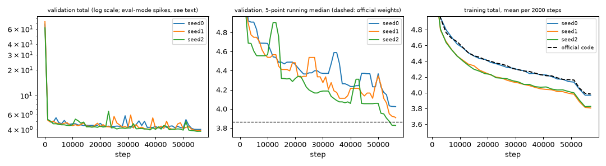
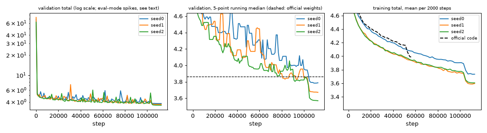

# Paint Transformer training runs (T-014)

**Question.** Does our reimplementation (T-011 to T-013), trained with the official recipe on the synthetic stroke generator, converge to a validation plateau
that is consistent across seeds, and does it match the official code? **Short answer:** yes, with one explained caveat (the sign of the stroke height, below).
Three seeds of the official 56,320-step recipe were not always flat enough before the learning-rate decay (pre-decay gain 0.5-1.05 %), so the recipe was stretched to
112,640 steps (decay at 92 % of the run, same shape): all three seeds then satisfy the plateau criterion. Our seed 0 and the *official code* trained with seed 0 end at the same
total (3.950 vs 3.944) and make the same sign choice, which is the strongest evidence that the reimplementation behaves like the original.

## Protocol
- Code: `python -m scripts.train_pt` (T-013), recipe of `configs/stroke_model/pt.yaml`: Adam lr 1e-4, betas (0.5, 0.999), batch 64, fp32, official loss preset, synthetic data generated on the fly, seeds 0/1/2 (the seed fixes the initialization and the training stream; the validation set is fixed by `val.seed`).
  *Official recipe*: `n_epochs 200 + 20 decay` (56,320 steps). *Stretched recipe*: `schedule.n_epochs=400 schedule.n_epochs_decay=40` (112,640 steps, 7.2 M samples), all other settings unchanged. Three runs shared the GPU at a time (about 88 ms per step each).
- During training: 512 fixed held-out patches every 1000 steps (eval mode). **Final evaluation** (`scripts.pt_training_report evaluate`): final checkpoint of every seed, the official pretrained weights (`model.pth`) and the official code retrained here, all on the **same 4096 held-out patches** (seed 999), same loss and matcher.
- **Plateau criterion** (fixed before looking at the stretched runs): relative improvement of the median training total between the windows [74 %, 83 %) and [83 %, 92 %) of the steps, i.e. the loss must be flat (< 1 %) *before* the learning-rate decay of the recipe is applied. Medians over 250-step block means. The validation gain is printed for information only (points every 1000 steps are too few and are polluted by the spikes explained below).
  The lr decay itself always gives a final drop of about 3 %, so a plain "last 10 % of the steps" window could never be flat; the "last-5 %" column shows that the end of the decay tail is stable (about 1 % or less).
- **Checkpoint-selection rule.** The final checkpoint of the run (end of the lr tail), not a best-on-validation one: the validation curve is too noisy for a best-of rule and the tail is the lowest-loss region anyway. Across seeds: the lowest total on the 4096-patch evaluation after the `|h|` canonicalization (see finding 2). Result: **`outputs/pt_long/seed2/latest.pt`** (total 3.547; seed 1 is within 0.003). Checkpoints stay in `outputs/` (never committed).
- Time and memory: one process alone does a step in 38 ms (T-013), i.e. 36 min / 71 min for the two recipes; with three processes sharing the GPU each took 83 / 181 minutes (column "time" below). Peak VRAM 851 MiB per run. The official code retrained once took **8.68 h (0.555 s per step, 56,320 steps)**, 2.3 times slower than the 0.237 s per step benchmarked in T-010; I did not investigate the gap.

## Results
Regenerate everything below with `python -m scripts.pt_training_report report` (it reads `docs/experiments/data/pt_training/`; the full logs and checkpoints live in `outputs/`).

<!-- BEGIN GENERATED -->

### Official recipe (56,320 steps)

| seed | steps | time (min) | peak VRAM (MiB) | pre-decay gain, train (criterion) | pre-decay gain, val | last-5 % gain, val |
|---|---|---|---|---|---|---|
| seed0 | 56320 | 83 | 851 | 1.05 % (NOT met) | 3.22 % | 0.24 % |
| seed1 | 56320 | 83 | 851 | 0.65 % (met) | -2.07 % | 0.94 % |
| seed2 | 56320 | 83 | 851 | 0.50 % (met) | -0.03 % | 1.15 % |

Final checkpoints on one held-out synthetic set (4096 patches, identical for all rows); `h<0` = fraction of matched strokes with a negative predicted height, `abs(h)` = loss after replacing `h` by `|h|`:

| model | total | pixel | L1 | Wasserstein | BCE | count error | h<0 | total, abs(h) |
|---|---|---|---|---|---|---|---|---|
| seed0 | 3.950 | 0.468 | 0.244 | 0.245 | 2.993 | 0.745 | 1.000 | 3.823 |
| seed1 | 3.731 | 0.458 | 0.100 | 0.238 | 2.935 | 0.754 | 0.000 | 3.731 |
| seed2 | 3.760 | 0.447 | 0.099 | 0.227 | 2.988 | 0.754 | 0.000 | 3.760 |
| official pretrained weights | 3.864 | 0.410 | 0.098 | 0.240 | 3.117 | 0.793 | 0.000 | 3.864 |
| official code retrained here (seed 0) | 3.944 | 0.461 | 0.245 | 0.247 | 2.992 | 0.765 | 1.000 | 3.811 |
| **ours, mean ± std over seeds** | 3.814 ± 0.119 | 0.458 ± 0.011 | 0.148 ± 0.084 | 0.237 ± 0.009 | 2.972 ± 0.032 | 0.751 ± 0.005 | 0.333 ± 0.577 | 3.771 ± 0.047 |



### Stretched recipe (112,640 steps)

| seed | steps | time (min) | peak VRAM (MiB) | pre-decay gain, train (criterion) | pre-decay gain, val | last-5 % gain, val |
|---|---|---|---|---|---|---|
| seed0 | 112640 | 181 | 851 | 0.83 % (met) | 0.16 % | 0.09 % |
| seed1 | 112640 | 181 | 851 | 0.79 % (met) | -0.93 % | 0.02 % |
| seed2 | 112640 | 181 | 851 | 0.79 % (met) | 2.71 % | 0.08 % |

Final checkpoints on one held-out synthetic set (4096 patches, identical for all rows); `h<0` = fraction of matched strokes with a negative predicted height, `abs(h)` = loss after replacing `h` by `|h|`:

| model | total | pixel | L1 | Wasserstein | BCE | count error | h<0 | total, abs(h) |
|---|---|---|---|---|---|---|---|---|
| seed0 | 3.708 | 0.418 | 0.242 | 0.229 | 2.819 | 0.707 | 1.000 | 3.584 |
| seed1 | 3.550 | 0.419 | 0.095 | 0.221 | 2.814 | 0.712 | 0.000 | 3.550 |
| seed2 | 3.547 | 0.416 | 0.096 | 0.211 | 2.825 | 0.726 | 0.000 | 3.547 |
| official pretrained weights | 3.864 | 0.410 | 0.098 | 0.240 | 3.117 | 0.793 | 0.000 | 3.864 |
| official code retrained here (seed 0) | 3.944 | 0.461 | 0.245 | 0.247 | 2.992 | 0.765 | 1.000 | 3.811 |
| **ours, mean ± std over seeds** | 3.602 ± 0.092 | 0.417 ± 0.002 | 0.144 ± 0.085 | 0.220 ± 0.009 | 2.819 ± 0.005 | 0.715 ± 0.010 | 0.333 ± 0.577 | 3.560 ± 0.021 |



<!-- END GENERATED -->

## Findings
1. **The recipe is not fully converged after 56,320 steps; the stretched one is.** Under constant lr the training total still falls by 0.5-1 % per 10 % of the run before the decay (official recipe) and by 0.8 % with the stretched recipe (criterion < 1 %: met for the three seeds, but only just, the curve decays slowly like a log). The 2x schedule improves the held-out total by about 5 % (3.73-3.76 -> 3.55 for seeds 1 and 2) and is 8 % below the **official pretrained weights** (3.864; per term: our pixel 0.416 vs 0.410, our BCE 2.82 vs 3.12, equal L1 and Wasserstein). The official weights were trained with the authors' own settings (the paper says batch 128 and 30k iterations), which may explain the difference; the comparison shows our runs are at least as good, not that the recipe is better.
2. **Seed outlier explained: the sign of `h`.** Seed 0 ends with L1 0.242 vs 0.096 for seeds 1 and 2 because **100 % of its matched strokes have a negative predicted height `h`** (L1 of `h` = 0.81 = 2 x 0.4). The Wasserstein distance depends on `h^2` only, and the PT renderer accepts a negative `h` (the brush is just mirrored), so only the weak parameter-L1 term prefers `h > 0`; the choice is made in the first few hundred steps and is a deterministic function of the seed.
   Evidence that it is not a bug of ours: the **official code trained with seed 0 makes the same choice** (h<0 = 1.000) and reaches total 3.944 / L1 0.245 against our 3.950 / 0.244 (pixel, Wasserstein and BCE within 2 %), while the official pretrained weights and our seeds 1 and 2 have h<0 = 0. With `h` replaced by `|h|` seed 0 goes from 3.950 to 3.823 (stretched: 3.708 to 3.584), still above seeds 1 and 2 because its pixel term is slightly worse. Consequence for downstream tickets: **use `|h|` (or the h>0 seeds)**; a flagged ablation that fixes the sign (e.g. `|h|` in the matching and L1 terms) is proposed as a new ticket. The mean ± std row therefore includes the outlier; the `abs(h)` column (3.560 ± 0.021 for the stretched recipe) is the relevant spread.
3. **Validation spikes are an eval-mode BatchNorm artefact, not training instabilities.** The validation curve shows isolated points 0.3 to 1.2 above the plateau (figure, left), always in the BCE term, while the training curve is smooth. Diagnosis on a fresh 8000-step run (seed 0): every 100 steps the validation set was scored with the running BN statistics (what `train.py` does), with batch statistics and with statistics re-estimated on 20 fresh batches. Running statistics differ from the re-estimated ones by more than 0.3 in 16 of 81 evaluations (max 1.23), and the spread (std) of the validation total along the run is 0.33 with running statistics against 0.11 recalibrated. At the end of a run (tiny lr) the two agree within 0.003 for the three official-recipe checkpoints, so **the final metrics are unaffected**; intermediate validation values are read through medians (the plateau criterion uses the training loss for the same reason). `train.py` was left unchanged (T-013 scope); an optional BN recalibration before evaluation is a proposed ticket. The diagnostic scripts were throw-away (not committed); the numbers above are from their logs.
4. **No divergence** in any of the six runs: the loss falls from about 69 to 5 within 500 steps and decreases afterwards (2000-step means).
5. **Seed spread among the h>0 seeds (1 and 2):** total 3.550 vs 3.547 (stretched) and 3.731 vs 3.760 (official recipe), i.e. 0.1 % and 0.8 %: small against the loss scale, as required.

## Hugging Face upload (prepared, not run)
`python -m scripts.upload_pt_to_hub --checkpoint outputs/pt_long/seed2/latest.pt --metrics-json outputs/pt_long/final_eval.json --seed-key seed2 --repo-id <user>/brushstroke-painttransformer` builds the staging folder `outputs/hub/painttransformer/`
(weights-only `pytorch_model.pth`, resolved config, SHA-256 of that config, model card with licence and metrics) and stops there; `--push` is required to upload (needs `huggingface_hub` and `HF_TOKEN`, neither installed here). The upload is a later decision.
Licence stated in the card: MIT (this repository); the weights are trained from scratch on synthetic data and none of the original authors' weights is redistributed.

## Reproduction
```
python -m scripts.fetch_pt_brushes ; python -m scripts.pt_reference_study fetch      # assets + official code and weights (outside git)
python -m scripts.train_pt seed=0 output_dir=outputs/pt_full/seed0                     # seeds 0,1,2 (official recipe)
python -m scripts.train_pt seed=0 output_dir=outputs/pt_long/seed0 schedule.n_epochs=400 schedule.n_epochs_decay=40
python -m scripts.pt_official_train --seed 0                                           # reference run of the official code (8.7 h here)
python -m scripts.pt_training_report evaluate --runs outputs/pt_full                   # and --runs outputs/pt_long
python -m scripts.pt_training_report archive  --runs outputs/pt_full --tag official_recipe   # and: --runs outputs/pt_long --tag long
python -m scripts.pt_training_report report                                            # tables + figures from docs/experiments/data/
```
