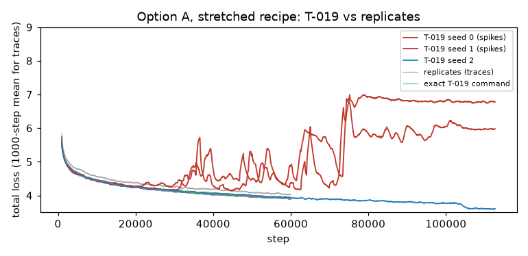

# Paint Transformer training runs (T-014)

**Question.** Does our reimplementation (T-011 to T-013), trained with the official recipe on the synthetic stroke generator, converge to a validation plateau
that is consistent across seeds, and does it match the official code? **Short answer:** yes, with one explained caveat (the sign of the stroke height, below).
Three seeds of the official 56,320-step recipe were not always flat enough before the learning-rate decay (pre-decay gain 0.5-1.05 %), so the recipe was stretched to
112,640 steps (decay at 92 % of the run, same shape): all three seeds then satisfy the plateau criterion. Our seed 0 and the *official code* trained with seed 0 end at the same
total (3.950 vs 3.944) and make the same sign choice, which is the strongest evidence that the reimplementation behaves like the original.

## Protocol
- Code: `python -m scripts.train_pt` (T-013), recipe of `configs/stroke_model/pt.yaml`: Adam lr 1e-4, betas (0.5, 0.999), batch 64, fp32, official loss preset, synthetic data generated on the fly, seeds 0/1/2 (the seed fixes the initialization and the training stream; the validation set is fixed by `val.seed`).
  *Official recipe*: `n_epochs 200 + 20 decay` (56,320 steps). *Stretched recipe*: `schedule.n_epochs=400 schedule.n_epochs_decay=40` (112,640 steps, 7.2 M samples), all other settings unchanged. Three runs shared the GPU at a time (about 88 ms per step each).
- During training: 512 fixed held-out patches every 1000 steps (eval mode). **Final evaluation** (`scripts.pt_training_report evaluate`): final checkpoint of every seed, the official pretrained weights (`model.pth`) and the official code retrained here, all on the **same 4096 held-out patches** (seed 999), same loss and matcher.
- **Plateau criterion** (fixed before looking at the stretched runs): relative improvement of the median training total between the windows [74 %, 83 %) and [83 %, 92 %) of the steps, i.e. the loss must be flat (< 1 %) *before* the learning-rate decay of the recipe is applied. Medians over 250-step block means. The validation gain is printed for information only (points every 1000 steps are too few and are polluted by the spikes explained below).
  The lr decay itself always gives a final drop of about 3 %, so a plain "last 10 % of the steps" window could never be flat; the "last-5 %" column shows that the end of the decay tail is stable (about 1 % or less).
- **Checkpoint-selection rule.** The final checkpoint of the run (end of the lr tail), not a best-on-validation one: the validation curve is too noisy for a best-of rule and the tail is the lowest-loss region anyway. Across seeds: the lowest total on the 4096-patch evaluation after the `|h|` canonicalization (see finding 2). Result: **`outputs/pt_long/seed2/latest.pt`** (total 3.547; seed 1 is within 0.003). Checkpoints stay in `outputs/` (never committed).
- Time and memory (**correction, T-016**: the 38 ms step of T-013 was re-measured at 94 ms alone on an idle GPU, so one process needs about 1.5 h for the official recipe and about 3 h for the stretched one; the 36 / 71 min below are the T-013 figures, kept as measured then): one process alone does a step in 38 ms (T-013), i.e. 36 min / 71 min for the two recipes; with three processes sharing the GPU each took 83 / 181 minutes (column "time" below). Peak VRAM 851 MiB per run. The official code retrained once took **8.68 h (0.555 s per step, 56,320 steps)**, 2.3 times slower than the 0.237 s per step benchmarked in T-010; I did not investigate the gap.

## Results
Regenerate everything below with `python -m scripts.pt_training_report report` (it reads `docs/experiments/data/pt_training/`; the full logs and checkpoints live in `outputs/`).

<!-- BEGIN GENERATED -->

### Official recipe (56,320 steps)

| seed | steps | time (min) | peak VRAM (MiB) | pre-decay gain, train (criterion) | pre-decay gain, val | last-5 % gain, val |
|---|---|---|---|---|---|---|
| seed0 | 56320 | 83 | 851 | 1.05 % (NOT met) | 3.22 % | 0.24 % |
| seed1 | 56320 | 83 | 851 | 0.65 % (met) | -2.07 % | 0.94 % |
| seed2 | 56320 | 83 | 851 | 0.50 % (met) | -0.03 % | 1.15 % |

Final checkpoints on one held-out synthetic set (4096 patches, identical for all rows); `h<0` = fraction of matched strokes with a negative predicted height, `abs(h)` = loss after replacing `h` by `|h|`:

| model | total | pixel | L1 | Wasserstein | BCE | count error | h<0 | total, abs(h) |
|---|---|---|---|---|---|---|---|---|
| seed0 | 3.950 | 0.468 | 0.244 | 0.245 | 2.993 | 0.745 | 1.000 | 3.823 |
| seed1 | 3.731 | 0.458 | 0.100 | 0.238 | 2.935 | 0.754 | 0.000 | 3.731 |
| seed2 | 3.760 | 0.447 | 0.099 | 0.227 | 2.988 | 0.754 | 0.000 | 3.760 |
| official pretrained weights | 3.864 | 0.410 | 0.098 | 0.240 | 3.117 | 0.793 | 0.000 | 3.864 |
| official code retrained here (seed 0) | 3.944 | 0.461 | 0.245 | 0.247 | 2.992 | 0.765 | 1.000 | 3.811 |
| **ours, mean ± std over seeds** | 3.814 ± 0.119 | 0.458 ± 0.011 | 0.148 ± 0.084 | 0.237 ± 0.009 | 2.972 ± 0.032 | 0.751 ± 0.005 | 0.333 ± 0.577 | 3.771 ± 0.047 |


### Stretched recipe (112,640 steps)

| seed | steps | time (min) | peak VRAM (MiB) | pre-decay gain, train (criterion) | pre-decay gain, val | last-5 % gain, val |
|---|---|---|---|---|---|---|
| seed0 | 112640 | 181 | 851 | 0.83 % (met) | 0.16 % | 0.09 % |
| seed1 | 112640 | 181 | 851 | 0.79 % (met) | -0.93 % | 0.02 % |
| seed2 | 112640 | 181 | 851 | 0.79 % (met) | 2.71 % | 0.08 % |

Final checkpoints on one held-out synthetic set (4096 patches, identical for all rows); `h<0` = fraction of matched strokes with a negative predicted height, `abs(h)` = loss after replacing `h` by `|h|`:

| model | total | pixel | L1 | Wasserstein | BCE | count error | h<0 | total, abs(h) |
|---|---|---|---|---|---|---|---|---|
| seed0 | 3.708 | 0.418 | 0.242 | 0.229 | 2.819 | 0.707 | 1.000 | 3.584 |
| seed1 | 3.550 | 0.419 | 0.095 | 0.221 | 2.814 | 0.712 | 0.000 | 3.550 |
| seed2 | 3.547 | 0.416 | 0.096 | 0.211 | 2.825 | 0.726 | 0.000 | 3.547 |
| official pretrained weights | 3.864 | 0.410 | 0.098 | 0.240 | 3.117 | 0.793 | 0.000 | 3.864 |
| official code retrained here (seed 0) | 3.944 | 0.461 | 0.245 | 0.247 | 2.992 | 0.765 | 1.000 | 3.811 |
| **ours, mean ± std over seeds** | 3.602 ± 0.092 | 0.417 ± 0.002 | 0.144 ± 0.085 | 0.220 ± 0.009 | 2.819 ± 0.005 | 0.715 ± 0.010 | 0.333 ± 0.577 | 3.560 ± 0.021 |


<!-- END GENERATED -->

## Findings
1. **The recipe is not fully converged after 56,320 steps; the stretched one is.** Under constant lr the training total still falls by 0.5-1 % per 10 % of the run before the decay (official recipe) and by 0.8 % with the stretched recipe (criterion < 1 %: met for the three seeds, but only just, the curve decays slowly like a log). The 2x schedule improves the held-out total by about 5 % (3.73-3.76 -> 3.55 for seeds 1 and 2) and is 8 % below the **official pretrained weights** (3.864; per term: our pixel 0.416 vs 0.410, our BCE 2.82 vs 3.12, equal L1 and Wasserstein). The official weights were trained with the authors' own settings (the paper says batch 128 and 30k iterations), which may explain the difference; the comparison shows our runs are at least as good, not that the recipe is better.
2. **Seed outlier explained: the sign of `h`.** Seed 0 ends with L1 0.242 vs 0.096 for seeds 1 and 2 because **100 % of its matched strokes have a negative predicted height `h`** (L1 of `h` = 0.81 = 2 x 0.4). The Wasserstein distance depends on `h^2` only, and the PT renderer accepts a negative `h` (the brush is just mirrored), so only the weak parameter-L1 term prefers `h > 0`; the choice is made in the first few hundred steps and is a deterministic function of the seed.
   Evidence that it is not a bug of ours: the **official code trained with seed 0 makes the same choice** (h<0 = 1.000) and reaches total 3.944 / L1 0.245 against our 3.950 / 0.244 (pixel, Wasserstein and BCE within 2 %), while the official pretrained weights and our seeds 1 and 2 have h<0 = 0. With `h` replaced by `|h|` seed 0 goes from 3.950 to 3.823 (stretched: 3.708 to 3.584), still above seeds 1 and 2 because its pixel term is slightly worse. Consequence for downstream tickets: **use `|h|` (or the h>0 seeds)**; a flagged ablation that fixes the sign (e.g. `|h|` in the matching and L1 terms) is proposed as a new ticket. The mean ± std row therefore includes the outlier; the `abs(h)` column (3.560 ± 0.021 for the stretched recipe) is the relevant spread.
3. **Validation spikes are an eval-mode BatchNorm artefact, not training instabilities.** The validation curve shows isolated points 0.3 to 1.2 above the plateau (figure, left), always in the BCE term, while the training curve is smooth. Diagnosis on a fresh 8000-step run (seed 0): every 100 steps the validation set was scored with the running BN statistics (what `train.py` does), with batch statistics and with statistics re-estimated on 20 fresh batches. Running statistics differ from the re-estimated ones by more than 0.3 in 16 of 81 evaluations (max 1.23), and the spread (std) of the validation total along the run is 0.33 with running statistics against 0.11 recalibrated. At the end of a run (tiny lr) the two agree within 0.003 for the three official-recipe checkpoints, so **the final metrics are unaffected**; intermediate validation values are read through medians (the plateau criterion uses the training loss for the same reason). `train.py` was left unchanged in T-013; the recalibration was added in T-020 (section below). The diagnostic scripts were throw-away (not committed); the numbers above are from their logs.
4. **No divergence** in any of the six runs: the loss falls from about 69 to 5 within 500 steps and decreases afterwards (2000-step means).
5. **Seed spread among the h>0 seeds (1 and 2):** total 3.550 vs 3.547 (stretched) and 3.731 vs 3.760 (official recipe), i.e. 0.1 % and 0.8 %: small against the loss scale, as required.

## Hugging Face upload (prepared, not run)
`python -m scripts.upload_pt_to_hub --checkpoint outputs/pt_long/seed2/latest.pt --metrics-json outputs/pt_long/final_eval.json --seed-key seed2 --repo-id <user>/brushstroke-painttransformer` builds the staging folder `outputs/hub/painttransformer/`
(weights-only `pytorch_model.pth`, resolved config, SHA-256 of that config, model card with licence and metrics) and stops there; `--push` is required to upload (needs `huggingface_hub` and `HF_TOKEN`, neither installed here). The upload is a later decision.
Licence stated in the card: MIT (this repository); the weights are trained from scratch on synthetic data and none of the original authors' weights is redistributed.

## Reproduction
```
python -m scripts.fetch_pt_brushes ; python -m scripts.pt_reference_study fetch      # assets + official code and weights (outside git)
python -m scripts.train_pt seed=0 output_dir=outputs/pt_full/seed0                     # seeds 0,1,2 (official recipe)
python -m scripts.train_pt seed=0 output_dir=outputs/pt_long/seed0 schedule.n_epochs=400 schedule.n_epochs_decay=40
python -m scripts.pt_official_train --seed 0                                           # reference run of the official code (8.7 h here)
python -m scripts.pt_training_report evaluate --runs outputs/pt_full                   # and --runs outputs/pt_long
python -m scripts.pt_training_report archive  --runs outputs/pt_full --tag official_recipe   # and: --runs outputs/pt_long --tag long
python -m scripts.pt_training_report report                                            # tables + figures from docs/experiments/data/
```

## T-019: fixing the `(w, h, theta)` convention and a convention-invariant `D_L1`

**Question.** Can the convention outliers of T-014 / T-016 (a seed predicts `h < 0` or `w < 0` for every stroke) be removed, or
neutralized in the metric, without losing quality? **Hypotheses.** H1: a convention fix (option A, B or C below) leaves 0 of
3 seeds with more than 50 % negative `w` or `h`, and the held-out total is not worse than the baseline recipe. H2: a
convention-invariant `D_L1` agrees across seeds. Derivation of the equivalence classes and of the options:
[docs/design/pt_convention.md](../design/pt_convention.md).

### Protocol (fixed before the runs)
- **Options** (flags, default = official behaviour, bitwise unchanged; checked by a forward and backward hash against `main`):
  **A** `model.convention=positive` (`w`, `h` = softplus, `theta` wrapped into [0, 1)); **B** `loss.l1_invariance=mirror` (parameter
  L1 of the loss and of the matching cost minimized over the mirror class of the prediction); **C** `loss.lambda_sign=10`
  (`+ 10 mean(relu(-w) + relu(-h))`, the weight of the other terms). Official recipe (56,320 steps), seeds 0, 1, 2, otherwise the
  T-014 settings. The stretched recipe (112,640 steps) only for the best option. Runs: `python -m scripts.exp_pt_convention train`.
- **Evaluation**: the T-014 held-out set (4,096 patches, seed 999, same loss and matcher) for every model, the new runs and
  the existing T-014 / T-016 checkpoints (`python -m scripts.exp_pt_convention evaluate`). Three totals of the official loss
  (weights 10 / 1 / 10 / 10): `raw`; `|h|` (T-014 protocol, `h` replaced by `|h|`); `invariant` (parameter L1 and matching over the
  mirror class). The invariant total is the **convention-neutral comparator**: it is the one used for H1, because options B and C
  may keep a negative sign that the raw total penalizes. Stroke metrics are the unweighted terms of T-016 plus `D_L1` per class
  level (`exact`, `mirror`, `rot180`, `swap`), all with the official matching.
- **H1 rule** (per option, 3 seeds): *outlier seed* = more than 50 % of the matched strokes with `w < 0` or `h < 0`; *worse* =
  mean invariant total above the baseline's and Welch t >= 2.13 (the T-017 rule); H1 is met when there is no outlier seed and the
  option is not worse. Baseline = the T-014 runs of the same length (official: 3.771 +- 0.047 after `|h|`; stretched: 3.560 +- 0.021).
  Option B keeps the sign free by design, so its outlier count is reported but it is judged on `D_L1` and on the total.
- **Best option** = the one that meets H1 with the lowest invariant total, else the fewest outlier seeds, then the lowest total.
- **H2 rule**: the coefficient of variation (std / mean over 3 seeds) of `D_L1` at a class level is at most 5 % and at least 3 times
  lower than the raw `D_L1`'s, for the two T-014 groups (official and stretched recipe); the four T-016 ablation groups are reported
  as supporting evidence. Levels: `exact` (strict: renders identically), `mirror` (primary), `rot180` and `swap` (diagnostics).

### Results
Regenerate with `python -m scripts.exp_pt_convention report` (reads `docs/experiments/data/pt_convention/`).

<!-- BEGIN CONVENTION -->

### Equivalence classes verified by rendering

Mean absolute alpha difference between the stroke and each parameter variant, 4000 random strokes of the training distribution (64 x 64 pixels; the mean alpha is 0.091); `error / area` is the share of the stroke that changes. Unrelated strokes of the same distribution differ by 0.1424 (1.57 of the area).

| variant `(sign w, sign h, theta shift, swap)` | class | alpha error (train) | error / area | foreground error (train) | alpha error (inference) |
|---|---|---|---|---|---|
| `(+1, +1, +1.0, -)` | rot180 (diagnostic) | 0.02753 | 0.303 | 0.03328 | 0.03325 |
| `(+1, -1, +0.0, -)` | mirror | 0.01310 | 0.144 | 0.01694 | 0.01191 |
| `(+1, -1, +1.0, -)` | rot180 (diagnostic) | 0.03047 | 0.336 | 0.03410 | 0.03638 |
| `(-1, +1, +0.0, -)` | rot180 (diagnostic) | 0.03047 | 0.336 | 0.03477 | 0.03643 |
| `(-1, +1, +1.0, -)` | mirror | 0.01310 | 0.144 | 0.01635 | 0.01196 |
| `(-1, -1, +0.0, -)` | rot180 (diagnostic) | 0.02753 | 0.303 | 0.03304 | 0.03325 |
| `(-1, -1, +1.0, -)` | exact | 0.00000 | 0.000 | 0.00306 | 0.00005 |
| `(+1, +1, +0.5, swap)` | swap (diagnostic) | 0.02840 | 0.313 | 0.03551 | 0.03261 |
| `(+1, +1, +1.5, swap)` | swap (diagnostic) | 0.02840 | 0.313 | 0.03539 | 0.03266 |
| `(+1, -1, +0.5, swap)` | swap (diagnostic) | 0.02776 | 0.306 | 0.03623 | 0.03136 |
| `(+1, -1, +1.5, swap)` | swap (diagnostic) | 0.02591 | 0.285 | 0.03192 | 0.03034 |
| `(-1, +1, +0.5, swap)` | swap (diagnostic) | 0.02591 | 0.285 | 0.03248 | 0.03039 |
| `(-1, +1, +1.5, swap)` | swap (diagnostic) | 0.02776 | 0.306 | 0.03575 | 0.03131 |
| `(-1, -1, +0.5, swap)` | swap (diagnostic) | 0.02840 | 0.313 | 0.03555 | 0.03266 |
| `(-1, -1, +1.5, swap)` | swap (diagnostic) | 0.02840 | 0.313 | 0.03571 | 0.03262 |

### H2: convention-invariant D_L1 on the existing checkpoints (T-014, T-016)

| model | L_pixel | D_L1 | D_L1 exact | D_L1 mirror | D_L1 rot180 | D_L1 swap | D_W | h < 0 | w < 0 | outlier seeds |
|---|---|---|---|---|---|---|---|---|---|---|
| official weights | 0.0410 | 0.0978 | 0.0978 | 0.0977 | 0.0947 | 0.0806 | 0.0240 | 0.0 % | 0.0 % | 0 / 1 |
| ours, official recipe (T-014) | 0.0458 ± 0.0011 | 0.1476 ± 0.0836 | 0.1471 ± 0.0828 | 0.1015 ± 0.0039 | 0.0990 ± 0.0044 | 0.0842 ± 0.0028 | 0.0237 ± 0.0009 | 33.3 ± 57.7 % | 0.0 ± 0.0 % | 1 / 3 |
| ours, stretched recipe (T-014) | 0.0417 ± 0.0002 | 0.1445 ± 0.0848 | 0.1439 ± 0.0837 | 0.0974 ± 0.0034 | 0.0947 ± 0.0037 | 0.0774 ± 0.0019 | 0.0220 ± 0.0009 | 33.3 ± 57.7 % | 0.0 ± 0.0 % | 1 / 3 |
| ablation w/o pixel (T-016) | 0.0665 ± 0.0017 | 0.1465 ± 0.0856 | 0.1460 ± 0.0847 | 0.0980 ± 0.0020 | 0.0963 ± 0.0022 | 0.0857 ± 0.0023 | 0.0223 ± 0.0009 | 33.3 ± 57.7 % | 0.0 ± 0.0 % | 1 / 3 |
| ablation w/o dl1 (T-016) | 0.0450 ± 0.0008 | 0.2403 ± 0.1248 | 0.2066 ± 0.0876 | 0.1190 ± 0.0128 | 0.1078 ± 0.0077 | 0.0805 ± 0.0037 | 0.0195 ± 0.0040 | 33.3 ± 57.7 % | 33.3 ± 57.7 % | 2 / 3 |
| ablation w/o dw (T-016) | 0.0449 ± 0.0003 | 0.1098 ± 0.0019 | 0.1098 ± 0.0019 | 0.1098 ± 0.0019 | 0.1082 ± 0.0023 | 0.0925 ± 0.0005 | 0.0299 ± 0.0005 | 0.0 ± 0.0 % | 0.0 ± 0.0 % | 0 / 3 |
| ablation w/o dbce (T-016) | 0.0426 ± 0.0003 | 0.2445 ± 0.1506 | 0.1908 ± 0.0834 | 0.1362 ± 0.0658 | 0.0985 ± 0.0054 | 0.0815 ± 0.0033 | 0.0238 ± 0.0008 | 66.7 ± 57.7 % | 33.3 ± 57.7 % | 2 / 3 |

**Spread of `D_L1` across the 3 seeds (coefficient of variation = std / mean).**

| group | raw | `\|h\|` fold | exact | mirror | rot180 | swap |
|---|---|---|---|---|---|---|
| ours, official recipe (T-014) | 56.7 % | 3.4 % | 56.3 % | 3.9 % | 4.5 % | 3.3 % |
| ours, stretched recipe (T-014) | 58.7 % | 2.8 % | 58.2 % | 3.5 % | 3.9 % | 2.4 % |
| ablation w/o pixel (T-016) | 58.4 % | 1.9 % | 58.0 % | 2.1 % | 2.3 % | 2.7 % |
| ablation w/o dl1 (T-016) | 51.9 % | 71.9 % | 42.4 % | 10.8 % | 7.1 % | 4.6 % |
| ablation w/o dw (T-016) | 1.7 % | 1.7 % | 1.7 % | 1.7 % | 2.1 % | 0.6 % |
| ablation w/o dbce (T-016) | 61.6 % | 58.5 % | 43.7 % | 48.3 % | 5.4 % | 4.0 % |

Bias of the invariant metric on the 22 models with no negative `w` or `h` (mean decrease of `D_L1` relative to the raw value; a level that lowers clean models also lowers wrong ones for the wrong reason): `exact` 0.0 %, `mirror` 0.1 %, `rot180` 3.2 %, `swap` 17.4 %.

Rule (H2 holds at a level): coefficient of variation across seeds at most 5 % and at least 3 times lower than the raw `D_L1`'s.

- `exact`: T-014 groups not both within the rule (no, no); ablation groups 0 / 4.
- `mirror`: T-014 groups both within the rule (yes, yes); ablation groups 1 / 4.
- `rot180`: T-014 groups both within the rule (yes, yes); ablation groups 1 / 4.
- `swap`: T-014 groups both within the rule (yes, yes); ablation groups 3 / 4.

### H1: the three options, official recipe (56,320 steps), 3 seeds

| option | total (raw) | total (`\|h\|`) | total (invariant L1) | invariant total vs baseline | h < 0 | w < 0 | outlier seeds |
|---|---|---|---|---|---|---|---|
| baseline (T-014) | 3.814 ± 0.119 | 3.771 ± 0.047 | 3.767 ± 0.042 | - | 33.3 ± 57.7 % | 0.0 ± 0.0 % | 1 / 3 |
| A: positive `w`, `h` (softplus), `theta` wrapped | 3.753 ± 0.042 | 3.753 ± 0.042 | 3.753 ± 0.042 | -0.015 (t = -0.43) | 0.0 ± 0.0 % | 0.0 ± 0.0 % | 0 / 3 |
| B: class-invariant L1 and matching (mirror class) | 3.891 ± 0.134 | 3.844 ± 0.135 | 3.756 ± 0.028 | -0.011 (t = -0.39) | 33.3 ± 57.7 % | 33.3 ± 57.7 % | 2 / 3 |
| C: penalty `relu(-w) + relu(-h)` (weight 10) | 3.754 ± 0.008 | 3.754 ± 0.008 | 3.753 ± 0.007 | -0.014 (t = -0.57) | 0.0 ± 0.0 % | 0.0 ± 0.0 % | 0 / 3 |

Stroke metrics of the same models:

| model | L_pixel | D_L1 | D_L1 exact | D_L1 mirror | D_L1 rot180 | D_L1 swap | D_W | h < 0 | w < 0 | outlier seeds |
|---|---|---|---|---|---|---|---|---|---|---|
| baseline, raw | 0.0458 ± 0.0011 | 0.1476 ± 0.0836 | 0.1471 ± 0.0828 | 0.1015 ± 0.0039 | 0.0990 ± 0.0044 | 0.0842 ± 0.0028 | 0.0237 ± 0.0009 | 33.3 ± 57.7 % | 0.0 ± 0.0 % | 1 / 3 |
| A: positive `w`, `h` (softplus), `theta` wrapped | 0.0451 ± 0.0002 | 0.0997 ± 0.0011 | 0.0997 ± 0.0011 | 0.0996 ± 0.0011 | 0.0972 ± 0.0014 | 0.0828 ± 0.0009 | 0.0230 ± 0.0002 | 0.0 ± 0.0 % | 0.0 ± 0.0 % | 0 / 3 |
| B: class-invariant L1 and matching (mirror class) | 0.0461 ± 0.0007 | 0.2553 ± 0.1581 | 0.2013 ± 0.0883 | 0.1052 ± 0.0080 | 0.1010 ± 0.0055 | 0.0820 ± 0.0041 | 0.0212 ± 0.0042 | 33.3 ± 57.7 % | 33.3 ± 57.7 % | 2 / 3 |
| C: penalty `relu(-w) + relu(-h)` (weight 10) | 0.0457 ± 0.0006 | 0.0998 ± 0.0006 | 0.0998 ± 0.0006 | 0.0998 ± 0.0006 | 0.0975 ± 0.0007 | 0.0830 ± 0.0007 | 0.0230 ± 0.0005 | 0.0 ± 0.0 % | 0.0 ± 0.0 % | 0 / 3 |

- **A: positive `w`, `h` (softplus), `theta` wrapped**: 0 / 3 outlier seeds; invariant total -0.015 vs baseline (Welch t = -0.43, critical 2.13): not worse; **H1 met**.
- **B: class-invariant L1 and matching (mirror class)**: 2 / 3 outlier seeds; invariant total -0.011 vs baseline (Welch t = -0.39, critical 2.13): not worse; **H1 not met**.
- **C: penalty `relu(-w) + relu(-h)` (weight 10)**: 0 / 3 outlier seeds; invariant total -0.014 vs baseline (Welch t = -0.57, critical 2.13): not worse; **H1 met**.

### Stretched recipe (112,640 steps) for the best option (A: positive `w`, `h` (softplus), `theta` wrapped)

| option | total (raw) | total (`\|h\|`) | total (invariant L1) | invariant total vs baseline | h < 0 | w < 0 | outlier seeds |
|---|---|---|---|---|---|---|---|
| baseline (T-014, stretched) | 3.602 ± 0.092 | 3.560 ± 0.021 | 3.556 ± 0.014 | - | 33.3 ± 57.7 % | 0.0 ± 0.0 % | 1 / 3 |
| A: positive `w`, `h` (softplus), `theta` wrapped | 7.379 ± 3.325 | 7.379 ± 3.325 | 7.379 ± 3.325 | +3.822 (t = +1.99) | 0.0 ± 0.0 % | 0.0 ± 0.0 % | 0 / 3 |

Stroke metrics of the same models:

| model | L_pixel | D_L1 | D_L1 exact | D_L1 mirror | D_L1 rot180 | D_L1 swap | D_W | h < 0 | w < 0 | outlier seeds |
|---|---|---|---|---|---|---|---|---|---|---|
| baseline, raw | 0.0417 ± 0.0002 | 0.1445 ± 0.0848 | 0.1439 ± 0.0837 | 0.0974 ± 0.0034 | 0.0947 ± 0.0037 | 0.0774 ± 0.0019 | 0.0220 ± 0.0009 | 33.3 ± 57.7 % | 0.0 ± 0.0 % | 1 / 3 |
| A: positive `w`, `h` (softplus), `theta` wrapped | 0.0872 ± 0.0402 | 0.1492 ± 0.0495 | 0.1492 ± 0.0495 | 0.1486 ± 0.0488 | 0.1364 ± 0.0376 | 0.1151 ± 0.0330 | 0.0575 ± 0.0310 | 0.0 ± 0.0 % | 0.0 ± 0.0 % | 0 / 3 |

- **A: positive `w`, `h` (softplus), `theta` wrapped** (stretched): 0 / 3 outlier seeds; invariant total +3.822 vs baseline (t = +1.99): not worse; **H1 met**.

<!-- END CONVENTION -->

### Findings (T-019)
- **The classes.** Exactly equivalent for the renderer: `theta` mod 2 and `(w, h, theta + 1) = (-w, -h, theta)` (alpha error 0 with the training brushes, 5e-5 with the inference ones). The mirror class (`h -> -h`) is *not* exact: 14.4 % of the stroke area differs. The Gaussian `D_W` is blind to the whole swap class, so only the parameter L1 prefers the ground-truth convention.
- **H2 (invariant `D_L1`): holds at the `mirror`, `rot180` and `swap` levels for both T-014 groups, not at `exact`** (the T-014 outlier seed uses the mirror, not the exact class). `mirror` is the primary level: its bias on clean models is 0.1 %, against 3.2 % (`rot180`) and 17.4 % (`swap`), which lower clean models too. The clean-bias column was added after a first look at the numbers, not pre-registered.
- **H1, official recipe: met by A and C, not by B.** A and C: 0 / 3 outlier seeds, invariant total 3.753 against 3.767 (baseline), t = -0.43 and -0.57, so no quality cost and no gain beyond noise (3 seeds). B keeps the sign free by design (the invariant L1 removes the penalty): 2 / 3 seeds end with negative signs (one `h < 0`, one `w < 0`), its raw `D_L1` is 0.255 but its invariant total is as good as the others. Best option by the pre-registered rule: **A** (3.7526 against C's 3.7533, a difference far inside the seed noise; A is also the only one that makes the convention hold by construction).
- **Negative result, stretched recipe: option A is unstable.** Seeds 0 and 1 degrade in the second half of the run (total from about 4.2 to about 6.1 and 6.8 in the training log, held-out invariant total 9.5 and 9.0, `L_pixel` 0.110, all 8 strokes of every patch painted), seed 2 behaves (3.549, better than the baseline's 3.556 +- 0.014). The pre-registered Welch rule reads t = +1.99 < 2.13, hence "not worse" and **H1 met on paper**; this is the test's lack of power on a bimodal 3-seed outcome, not evidence of equivalence. Our verdict: **A does not hold on the stretched recipe** (2 / 3 divergent seeds against 0 / 3 for the baseline). The cause was not found in T-023 (the degradation did not reproduce in 9 replicates; see the T-023 section; candidates: the softplus floor on `w`, `h` giving vanishing gradients for small strokes, the unbounded `theta - floor(theta)` jump in the matching cost, the constant learning rate of 1e-4 over 400 epochs). The other options were not run stretched (protocol: best option only), so whether C is stable there is unknown.
- **Practical outcome.** The invariant `D_L1` (mirror level) is what to report from now on. For training, A or C remove the convention outliers on the official recipe; on the stretched recipe none of the options is validated.

## T-020: a usable validation curve (BatchNorm statistics of the validation)

`val.bn` of `train.py` (`running` | `recalibrate` | `batch`, default `recalibrate`; design note [pt_bn_validation.md](../design/pt_bn_validation.md))
scores the validation set with statistics that are not the lagging running averages. The diagnostic below reproduces the T-014 one
(8000 steps, seed 0): same network, same steps, every mode evaluated in the same run. Decision: **`recalibrate` (K = 20)** is the
default: as smooth as `batch` (max difference 0.041) without depending on the batch composition.

<!-- BEGIN BN -->

Diagnostic run of 8000 steps (seed 0, official recipe, validation every 100 steps = 81 evaluations of the same network with every mode; `python -m scripts.exp_pt_bn_validation run`). Statistics over the evaluations from step 1000 on (the first thousand steps are the initial descent); residual = value minus the median of 7 neighbouring evaluations.

| validation statistics | std of the curve | std of the residual to the local median | spikes > 0.3 | largest spike |
|---|---|---|---|---|
| running statistics (before) | 0.300 | 0.222 | 10 / 71 | 0.928 |
| recalibrated, K = 5 batches | 0.199 | 0.081 | 2 / 71 | 0.320 |
| recalibrated, K = 20 batches | 0.200 | 0.080 | 2 / 71 | 0.315 |
| recalibrated, K = 50 batches | 0.199 | 0.086 | 1 / 71 | 0.392 |
| batch statistics | 0.201 | 0.081 | 2 / 71 | 0.342 |

- Running statistics differ from the recalibrated ones (K = 20) by more than 0.3 in 12 of 81 evaluations (largest difference 1.420); at the last step the two totals are 4.606 and 4.605.
- Recalibration with K = 20 and with K = 50 batches differ by at most 0.064; recalibrated and batch statistics differ by at most 0.041.
- Training weights (40 steps on the CPU, batch 16, SHA-256 of the state dict): `running` d700ab75d5d5497c, `recalibrate` d700ab75d5d5497c, `batch` d700ab75d5d5497c -> **identical**.

<!-- END BN -->

## T-023: late-training degradation of convention option A on the stretched recipe

**Verdict: root cause not found; the degradation did not reproduce.** Option A (`model.convention=positive`) on the stretched recipe (`schedule.n_epochs=400`) degraded in 2 of the 3 T-019 runs and in none of the 9 option-A replicates run here (7 traces with seeds 0, 1, 2, 5 and 6, and the exact T-019 command re-run for seeds 0 and 1 up to step 48,000; the raw-convention control is a tenth run, also without spike). Hypotheses H1 to H4 could therefore not be tested by a causal branch experiment (no checkpoint before a spike could be captured), and no fix is proposed.



### Onset, from the stored T-019 logs

- **The 1.25x rule is a late marker.** Its first crossings are at 37,450 (seed 0) and 35,625 (seed 1), then about every 10,000 steps (5 and 4 spikes in 112,640 steps); seed 2 has none. The departure from the same-seed rerun (`T19_s*`, 100-step mean of the total loss more than 0.1 above it; the largest difference in the first 20,000 steps is 0.05) is far earlier: **step 31,100 for seed 1** (4,500 steps before its spike) and **step 20,900 for seed 0**, which is a stall (total 4.30 to 4.38 while the rerun and the healthy seed 2 go down to 4.10 to 4.18) followed by excursions at about 30,800 and 33,175 before the spike. So seed 1 is an abrupt excursion, seed 0 a slow stall that ends in excursions: "abrupt jump" does not describe seed 0.
- **First-moving term.** With the early alert (100-step mean more than 4 standard deviations above the median of the previous 2000 steps; table below), the first excursion of each seed shows the same order at the resolution of the log (25 steps): the `pixel` and `w` (Wasserstein) terms cross first (seed 1: pixel 31,125, total and `w` 31,175; seed 0: pixel, `w` and total at 33,175), the `decision` term follows 400 to 575 steps later (seed 1: 31,750; seed 0: 33,575) and the `gt` term (L1 on the parameters) never crosses. The later excursions do not keep this order (simultaneous within 25 to 75 steps, or only the `decision` term moves), so it is a property of the first excursion only, on 2 seeds. Read as a hint, not a result: the shape terms (position and size of the strokes, `pixel`, `w`) degrade before the stroke-count decision, and the parameter L1 that carries the `theta` wrap does not lead, which weighs against the `theta` discontinuity in the L1 (H2) and says nothing about the matching cost.
- The same scan finds no spike in the controls of T-019/T-021: option A on the official length (3 seeds) and the raw convention on the stretched recipe (3 seeds), and none in the raw-convention trace here. The early alert fires on neither healthy T-019 run nor on the exact-command reruns before 48,000 steps.
- Final state of the two degraded runs (stored `latest.pt`): the network outputs an input-independent constant for every stroke and patch. The CNN and 1x1-conv activations still vary (std about 0.57) but the `transformer.encoder` output is nearly constant (std below 0.01 on a batch of 64 patches, 0.0003 to 0.008 depending on the batch, against 0.72 for the healthy seed 2): a rank collapse of the transformer encoder. `softplus(w)`, `softplus(h)` are not saturated (about 0.41 and 0.40). Seed 0 has a raw `theta` of about -46.5.

### Replicates (0 spike out of 9)

The replicates are not 9 independent draws: `A_s0`, `A_s0v` and `T19_s0` share seed 0 (and likewise for seed 1), so the effective number of independent runs is 5 (seeds 0, 1, 2, 5, 6) and the probabilities below are optimistic.

Same recipe and seeds as T-019, instrumented per step (gradient norm per group, Adam update ratio, `enc_std`, raw `theta`, fraction of `theta` within 0.02 of the wrap boundary). GPU training is not bitwise reproducible, and the replicates share the T-019 data seeds, yet seed 1 follows T-019 until about step 31,000 and seed 0 until about 21,000, and both then stay on a healthy path (total about 4.0 at 45,000 against 4.5 and 4.2 for T-019 on the same steps). In the table, `validation: T-019` means the periodic validation with running BatchNorm statistics that the T-019 runs had; `T19_s*` are runs of the exact `scripts.train_pt` command of T-019 (stopped at 48,000 steps), so the difference with T-019 is not my training loop, nor the validation. The code paths used for training are unchanged since T-019 (the later commits only touch validation and a comment).

If the spike rate were the 2 / 3 seen in T-019, 0 / 9 would have probability (1/3)^9 = 5e-5 (with 5 independent seeds, (1/3)^5 = 0.004); pooling the three T-019 runs with the nine replicates, the T-019 outcome (2 spikes in 3 runs) has probability about 0.045 under a common rate (hypergeometric, 2 / 12). So the T-019 failure is either a rare event (rate of the order of 10 to 20 %) or due to a condition of that session that I could not recover (concurrent load, GPU state, driver); the logs do not contain it.

### Verdict per hypothesis

| hypothesis | verdict | evidence |
|---|---|---|
| H1: saturation of the positive activation | **not supported** | softplus outputs of the collapsed models are about 0.4, far from the floor; the collapse is in the transformer encoder, not at the head. No causal test (no spike to branch from) |
| H2: `theta` wrap discontinuity | **not supported, not excluded** | the parameter L1 (`gt`, which carries `theta`) is the last term to move and never crosses at the first excursions, while `pixel` and `w` lead; in healthy runs raw `theta` stays within about 1 to 2.5 and at most 6 % of the angles are near the boundary, without damage; the raw -46 of seed 0 appears in the collapsed state, so it is a consequence. No causal test |
| H3: constant learning rate of the stretched recipe | **not supported** | official and stretched recipes have identical lr for steps < 51,200 and the first spikes are at 35,625 and 37,450; no replicate spikes under the same lr to step 60,000; the raw control and option A on the official length never spike |
| H4: BatchNorm statistics / numerics | **not supported, not excluded** | the replicates and the exact-command runs use the same fp32 BatchNorm path as T-019 and stay healthy; no causal test |

Other observations: gradient norms of the healthy runs reach 430 to 630 against a median of 40 to 45 (a factor 10 to 15) without any consequence, so a single large gradient is not sufficient to trigger the collapse. The transformer encoder output std of healthy replicates is 0.78 to 0.89.

### What would be needed

A branch from a checkpoint before the onset, with one factor changed at a time (`--lr-scale`, `--theta none`, `--wh exp`, `--bn-eval`, `--grad-clip`, `--beta1`; implemented and unit-tested in `scripts/exp_pt_instability.py branch`, including an end-to-end test). The first version of the tool was not able to give that branch point: the 1.25x rule fires 4,500 steps (seed 1) to more than 4,200 steps (seed 0) after the onset, and 4,000 steps of checkpoints were kept. The tool now has an online early alert (the score above, which fires at 31,175 for seed 1, 75 steps after its departure at 31,100, and at 33,175 for seed 0, whose stall starts at 20,900), keeps the last 12,000 steps of checkpoints (24 files of 109 MB), freezes the rotation while an alert is in force and unfreezes it after 4,000 steps without spike, and `branch` takes its default `--back 2000` before the alert (`--back 11000` to start before the stall of a seed-0 type run). The alert has false alarms on healthy runs: 2 of the 11 healthy logs (`A_s5` at 58,735 and `A_s6` at 59,583, both transients of a few steps); they cost only a pause of the rotation.

Proposed ticket (P3): run option A stretched over many seeds in the background (about 10 runs of 60,000 steps at the observed rate, 3 hours each when two run side by side), stop at the first spike following an alert, then run the single-factor branches from the retained checkpoints; or accept that option A is not validated on the stretched recipe, as stated in T-019 (the official recipe is unaffected).

### Replicate table (generated: `python -m scripts.exp_pt_instability report`)

<!-- BEGIN T023 -->

| run | source | convention | validation | steps | spikes (first) | `enc_std` (min / median) | raw theta max (median / max) |
|---|---|---|---|---|---|---|---|
| T-019 seed 0 | stored log | positive | T-019 | 112640 | 5 (37450) | - | - |
| T-019 seed 1 | stored log | positive | T-019 | 112640 | 4 (35625) | - | - |
| T-019 seed 2 | stored log | positive | T-019 | 112640 | 0 (-) | - | - |
| A_s0 | trace (this study) | positive | none | 60000 | 0 (-) | 0.813 / 0.848 | 0.95 / 1.24 |
| A_s1 | trace (this study) | positive | none | 60000 | 0 (-) | 0.805 / 0.844 | 0.96 / 1.21 |
| A_s2 | trace (this study) | positive | none | 60000 | 0 (-) | 0.782 / 0.820 | 1.45 / 2.34 |
| A_s0v | trace (this study) | positive | T-019 | 60000 | 0 (-) | 0.814 / 0.849 | 1.18 / 2.45 |
| A_s1v | trace (this study) | positive | T-019 | 60000 | 0 (-) | 0.808 / 0.844 | 0.88 / 1.17 |
| A_s5 | trace (this study) | positive | T-019 | 60000 | 0 (-) | 0.792 / 0.835 | 0.98 / 1.24 |
| A_s6 | trace (this study) | positive | T-019 | 60000 | 0 (-) | 0.778 / 0.819 | 0.79 / 1.32 |
| R_s0 | trace (this study) | raw | none | 60000 | 0 (-) | 0.817 / 0.850 | 0.85 / 1.24 |
| T19_s0 | `scripts.train_pt`, T-019 command | positive | T-019 | 48000 | 0 (-) | - | - |
| T19_s1 | `scripts.train_pt`, T-019 command | positive | T-019 | 48000 | 0 (-) | - | - |

| T-019 seed | departs from its rerun | first alerts (before 48,000) | first step with score > 4, per term at the first alert (total / pixel / gt / w / decision) | first 1.25x spike |
|---|---|---|---|---|
| 0 | 20900 | 33175, 35475, 37425, 41900, 46825 | 33175 / 33175 / None / 33175 / 33575 | 37450 |
| 1 | 31100 | 31175, 35625, 38425, 41650, 45625 | 31175 / 31125 / None / 31175 / 31750 | 35625 |

<!-- END T023 -->
